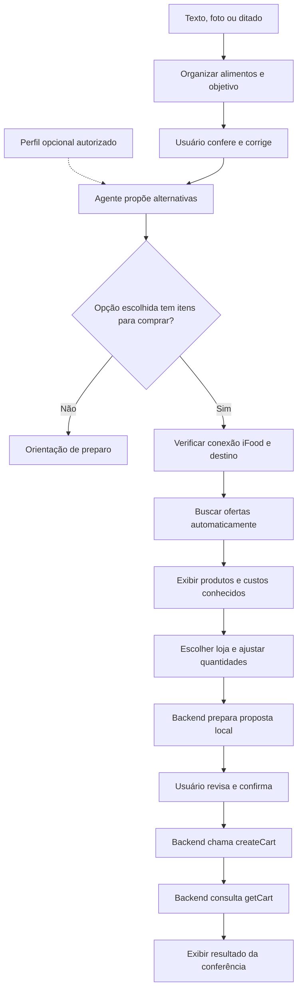

# 02. Desenho da solução

## Do contexto à escolha de produtos

A CompletAI transforma uma necessidade de refeição em opções de preparo e compra. A pessoa informa o que tem e o que pretende fazer. O agente organiza esse contexto, recomenda alternativas e busca ofertas no iFood quando uma opção com itens para comprar é escolhida.

A interface apresenta quatro momentos: **Sua despensa**, **Sugestões do agente**, **Só o que falta** e **Carrinho**. A revisão dos alimentos faz parte do primeiro momento. Perfil, conexão iFood e acessibilidade ficam disponíveis ao longo da jornada.

## Exemplo mostrado nas telas

Nas [capturas da aplicação](04-interface-visual.md), a pessoa parte de alimentos reconhecidos em uma foto e confirma um contexto de almoço em família para quatro pessoas. O agente apresenta três possibilidades:

| Caminho | Sugestão exibida | Relação com a compra |
|---|---|---|
| Aproveitar o que tem | Salada com molho de iogurte e limão | Pode terminar sem compra |
| Completar no iFood Mercado | Espaguete ao molho de tomate com salada verde | Busca espaguete para completar os ingredientes |
| Conveniência | Refeição pronta de restaurante com salada verde | Permite buscar uma opção pronta no iFood |

A pessoa escolhe o espaguete, define o endereço e recebe uma oferta do catálogo. Depois de revisar e confirmar, a tela apresenta um carrinho com uma embalagem do produto e informa que os itens foram conferidos.

Esse exemplo mostra o caminho comercial implementado. O preço unitário da captura é uma observação daquela consulta. O mínimo da loja precisa de revisão e o total do carrinho não foi informado pelo MCP. A conferência dos itens não comprova que a compra possa ser concluída por aquele valor.

## Fluxo principal

### 1. Informar e conferir

Texto e ditado viram uma mensagem para o agente. Câmera e upload enviam uma imagem ao agente de reconhecimento. Na captura, o sistema organiza alimentos e detalhes do pedido; ainda não pesquisa produtos.

A revisão permite corrigir nomes, incluir ou remover ingredientes e ajustar objetivo, pessoas, tempo e orçamento. A interface atual exige pelo menos um ingrediente válido para avançar. A foto não confirma quantidade, validade ou conservação.

### 2. Recomendar com o contexto autorizado

O planejamento usa os ingredientes confirmados e o perfil que a pessoa escolheu compartilhar. “Meu perfil” é opcional e pode ser lembrado no navegador. A conexão com o iFood não importa preferências alimentares.

O agente pode retornar até três opções, com ingredientes usados, faltantes e justificativa. Também sugere complementos opcionais. A escolha de uma opção sem faltantes leva à orientação de preparo; ainda não há um caminho dedicado para comprar os complementos dessa opção.

### 3. Encontrar uma oferta pertinente

A conta iFood pode ser conectada desde a entrada. Na etapa comercial, a aplicação consulta os endereços e usa o destino selecionado para a busca. Quando escolha, conexão e localização estão prontas, a consulta começa automaticamente.

Ingredientes favorecem o iFood Mercado. Refeições e acompanhamentos prontos podem usar restaurantes. A busca considera parceiros abertos; uma consulta vazia em uma categoria pode ser ampliada para o catálogo geral, mantendo filtros e destino. Há um limite de três buscas por execução.

Sem produtos adequados, a interface permite solicitar novas alternativas prontas. Essa mudança passa por uma nova escolha do usuário; o agente não troca a refeição escolhida durante a busca. Explorar por localização também é possível, mas criar carrinho exige um endereço salvo válido.

### 4. Montar, revisar e confirmar

As ofertas são agrupadas por loja. O usuário escolhe uma loja, ajusta quantidades e pode remover itens. O backend prepara uma proposta com produtos observados no MCP, endereço, valores conhecidos, prazo e identificador de revisão.

A proposta é local: essa etapa ainda não cria um carrinho no iFood. Após a revisão, a confirmação autoriza `createCart`. Em seguida, `getCart` confere o identificador, os itens e as quantidades. Cada proposta corresponde a uma única loja.

## Quem decide e quem executa

| Parte | Responsabilidade |
|---|---|
| Usuário | Confirmar o contexto, escolher a sugestão, definir destino e aprovar o carrinho |
| Frontend | Apresentar etapas, coletar decisões e invalidar resultados quando o contexto muda |
| Agente com OpenAI Agents SDK | Interpretar informações, recomendar opções e consultar ofertas pela ferramenta de busca |
| Backend FastAPI | Validar contexto, vincular produtos ao destino e controlar proposta, criação e conferência |
| MCP oficial do iFood | Retornar ofertas e endereços, criar o carrinho e permitir sua consulta |

O agente recebe uma ferramenta local de leitura, ligada a `searchOffers`. As chamadas `listAddresses`, `createCart` e `getCart` são controladas pelo backend. Nomes comerciais, identificadores e preços são obtidos das respostas do MCP.

## Mudanças e resultados incompletos

| Situação | Comportamento |
|---|---|
| Perfil alterado | Descarta recomendações e resultados comerciais para usar o novo contexto |
| Endereço alterado | Descarta a busca anterior e exige nova consulta para o destino |
| Conta reconectada | Limpa o estado comercial anterior e ignora respostas atrasadas da conexão antiga |
| Busca com erro | Informa falha, sem dizer que o catálogo está vazio |
| Proposta expirada | Exige revisão antes de confirmar |
| Criação com resultado incerto | Bloqueia a repetição automática para evitar duplicidade |
| Carrinho criado, leitura incompleta | Preserva o carrinho e informa que a conferência não foi concluída |
| Identidade, itens ou quantidades divergentes | Retorna divergência em vez de confirmar sucesso |

A proposta vale por 10 minutos; as evidências de produtos, por 30 minutos. A confirmação também verifica se os produtos foram encontrados para o endereço escolhido. Considerar o orçamento nos filtros não garante que o subtotal, frete e mínimo da loja caibam nele.

## Onde a jornada termina

O resultado pode ser uma orientação de preparo sem compra, um carrinho criado e conferido ou um carrinho criado que ainda precisa de conferência. Pagamento e envio do pedido ficam fora desta versão. Um link de abertura só aparece quando foi retornado pelo MCP e aceito pela validação; a presença na sacola principal do app não é presumida.

## Referências

- [Interface e capturas do exemplo](04-interface-visual.md)
- [Fluxo da aplicação](../../frontend/src/App.tsx)
- [Ofertas e alternativas](../../frontend/src/steps/MarketStep.tsx)
- [Montagem e revisão do carrinho](../../frontend/src/steps/CartStep.tsx)
- [Agente](../../backend/app/agent.py) e [controle do carrinho](../../backend/app/cart.py)
