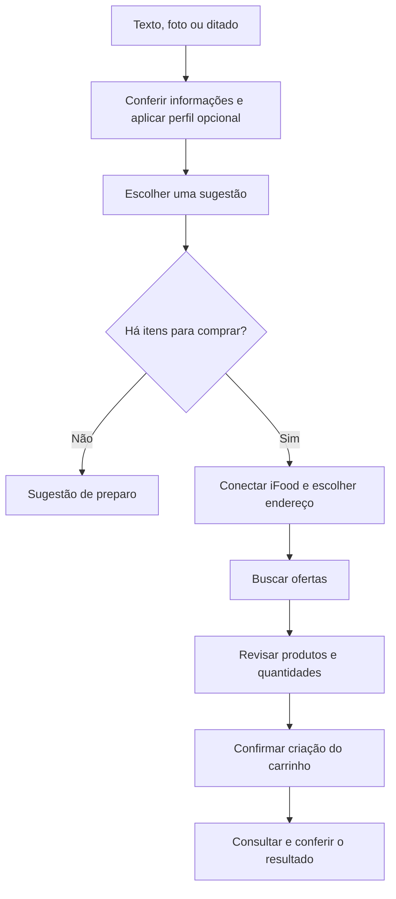

# 02. Desenho da solução

A jornada começa com a ocasião e termina, quando há compra, com a conferência do carrinho criado no iFood.

## Da intenção à recomendação

1. **Contar o que precisa.** A pessoa digita, dita ou envia uma foto. Pode informar o objetivo, o número de pessoas, o tempo disponível e o orçamento.
2. **Conferir as informações.** O agente organiza o que reconheceu. A pessoa corrige ingredientes e contexto antes de continuar. Na interface atual, é preciso confirmar pelo menos um ingrediente para avançar ao planejamento.
3. **Usar o perfil.** Preferências já autorizadas entram na recomendação. “Meu perfil” pode ser aberto para preencher ou editar essas informações, sem uma etapa obrigatória de cadastro. Alergias, intolerâncias e condições de saúde exigem consentimento.
4. **Escolher uma sugestão.** O agente propõe até três opções: aproveitar os ingredientes disponíveis, completar com compras ou buscar uma refeição pronta. Também pode sugerir acompanhamentos opcionais.

## Da escolha ao carrinho

5. **Conectar o iFood e escolher o destino.** A conta pode ser conectada desde a tela inicial. Na etapa de ofertas, a aplicação consulta os endereços; o destino escolhido define onde buscar produtos. Também é possível explorar por localização, mas esse caminho não habilita carrinho sem um endereço válido.
6. **Encontrar produtos.** Escolher uma opção com faltantes autoriza a busca. Quando conexão e localização estão prontas, o agente consulta o catálogo automaticamente para atender à escolha. A interface apresenta os produtos, as lojas e os preços retornados pelo MCP.
7. **Revisar a compra.** A pessoa escolhe entre as lojas apresentadas, ajusta as quantidades e pode remover itens. Cada proposta reúne produtos de uma única loja. A aplicação exibe uma revisão antes de criar qualquer carrinho no iFood.
8. **Confirmar.** O backend cria o carrinho com `createCart` e consulta `getCart` para conferir o identificador, os itens e as quantidades.

Se a opção escolhida não precisa de compras, a jornada pode terminar com a sugestão de preparo. Os complementos aparecem nas recomendações, mas ainda falta um fluxo dedicado para comprá-los nesse caso.

## Quando o fluxo precisa se adaptar

Uma busca sem resultados em uma categoria pode ser ampliada para o catálogo geral, respeitando o limite de três consultas. Erro de integração é tratado como falha, sem concluir que não existem ofertas.

Se o usuário troca o endereço, precisa buscar novamente para o novo destino. Uma nova conexão iFood também limpa o estado comercial anterior.

Se a criação do carrinho tiver resultado incerto, o sistema bloqueia a repetição automática. A interface distingue um carrinho conferido de um carrinho criado cuja conferência não foi concluída. A exibição na sacola principal do aplicativo não está garantida.

## Referências no projeto

[Fluxo da aplicação](../../frontend/src/App.tsx), [revisão](../../frontend/src/steps/ReviewStep.tsx) e [carrinho](../../frontend/src/steps/CartStep.tsx).
