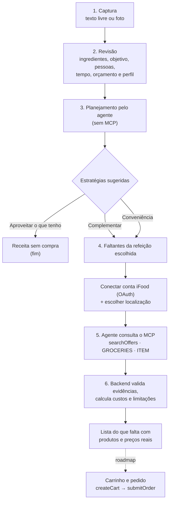
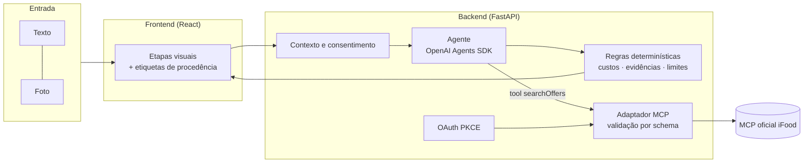

# 02 — Desenho de Solução

Como a Despensa Reversa resolve o problema, do contexto do consumidor até os
produtos reais do iFood Mercado.

## Princípio

> A IA interpreta, planeja e explica. O backend valida, calcula e controla.
> O MCP fornece as capacidades comerciais disponíveis.

## Fluxo geral

## Etapas

| # | Etapa | Quem faz | O que acontece |
|---|---|---|---|
| 1 | **Captura** | Usuário | Descreve o que tem em casa e o objetivo ("Tenho arroz, ovos, tomate e cenoura. Jantar para duas pessoas, 30 min, até R$ 35."). Opcionalmente tira ou envia uma foto. |
| 2 | **Revisão** | Agente → usuário | O agente extrai ingredientes e contexto, todos marcados como *sugerido pela IA*. A pessoa corrige nomes e quantidades, ajusta objetivo e preferências e confirma. Nada inferido é usado sem confirmação. |
| 3 | **Planejamento** | Agente | Com o inventário confirmado e o perfil, o agente propõe opções nas três estratégias: aproveitar, complementar ou conveniência. Esta etapa não chama o MCP nem exige login no iFood. |
| 4 | **Escolha** | Usuário | Escolher uma refeição com faltantes autoriza a busca desses itens. Se não falta nada, o fluxo termina sem compra. |
| 5 | **Consulta comercial** | Agente + MCP | Após OAuth e escolha da localização, o agente faz até três buscas distintas em `searchOffers` (iFood Mercado, resultados por item), com filtros reais: restrições alimentares, preço máximo, frete máximo e ordenação. |
| 6 | **Recomendação** | Backend | O backend preenche nomes, IDs e preços **somente** a partir das respostas do MCP nesta execução, descarta seleções sem evidência, calcula custos por opção em centavos e lista as limitações (embalagem, taxas, pedido mínimo, total não confirmado). |
| 7 | **Compra** | — | **Não implementada nesta versão.** A interface diz claramente que nada foi adicionado ao carrinho. Roadmap: `createCart` → `getCart` → revisão → confirmação explícita → `submitOrder`. |

## Separação em camadas

- **Entrada:** texto e imagem viram a mesma representação estruturada. O núcleo
  não depende do formato de entrada, o que abre caminho para voz e outros canais.
- **Contexto:** inventário confirmado, perfil, orçamento, tempo e localização
  ficam no backend, nunca na memória do modelo.
- **Agente:** um único agente com uma única ferramenta comercial, somente
  leitura. Não há arquitetura multiagente sem justificativa.
- **Regras determinísticas:** valores, vínculos com o MCP e limites ficam no
  backend, em código testado.
- **Integração:** o adaptador valida os argumentos contra o schema anunciado pelo
  próprio MCP antes de cada chamada.

## Garantias do fluxo

- Nenhum produto, preço ou loja é inventado. Se a busca vier vazia ou falhar, a
  tela informa isso, e falha não é apresentada como "nada encontrado".
- Preferências alimentares nunca viram promessa de segurança. Alergia a leite não
  vira filtro "sem lactose", e diabetes não vira "sem açúcar".
- A localização é enviada só ao MCP, nunca ao modelo.
- Nenhuma ação comercial acontece sem confirmação explícita.

## Expansão para outras verticais

O mesmo fluxo atende outros cenários trocando apenas as regras da vertical:

- **Petshop:** "A ração do meu gato está acabando" → perfil do animal →
  `searchOffers` com `merchantType=PETSTORE`.
- **Farmácia:** "Meu protetor solar está acabando" → reposição de cuidados
  pessoais com `merchantType=DRUGSTORE`, sem recomendar medicamentos.

Captura, perfil, sessão, agente, validação e auditoria são compartilhados.
