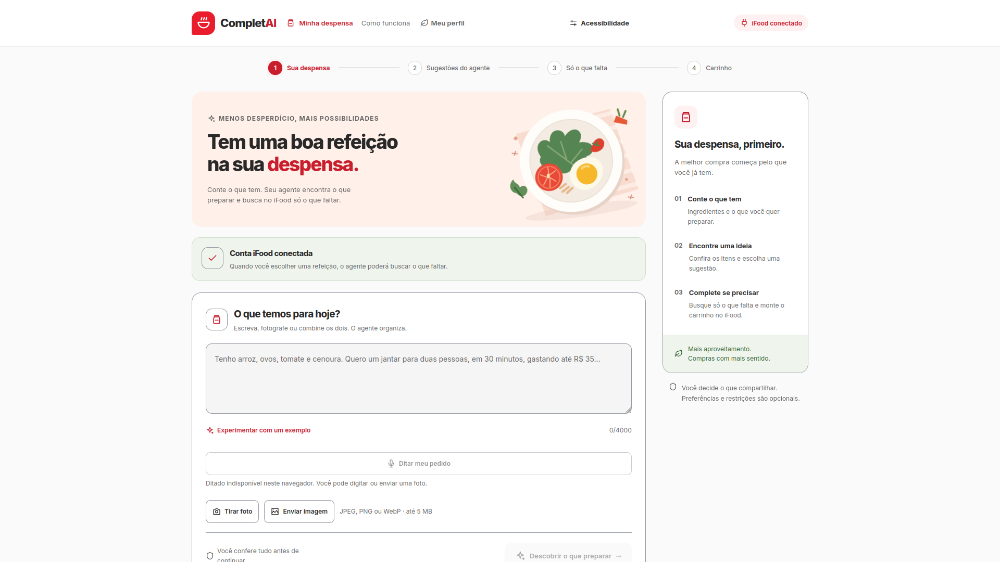
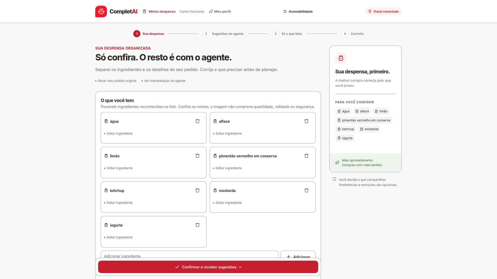
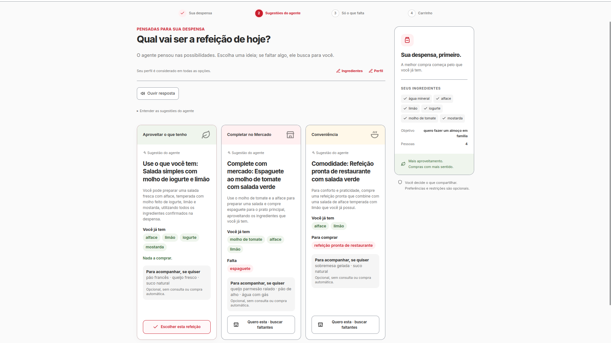
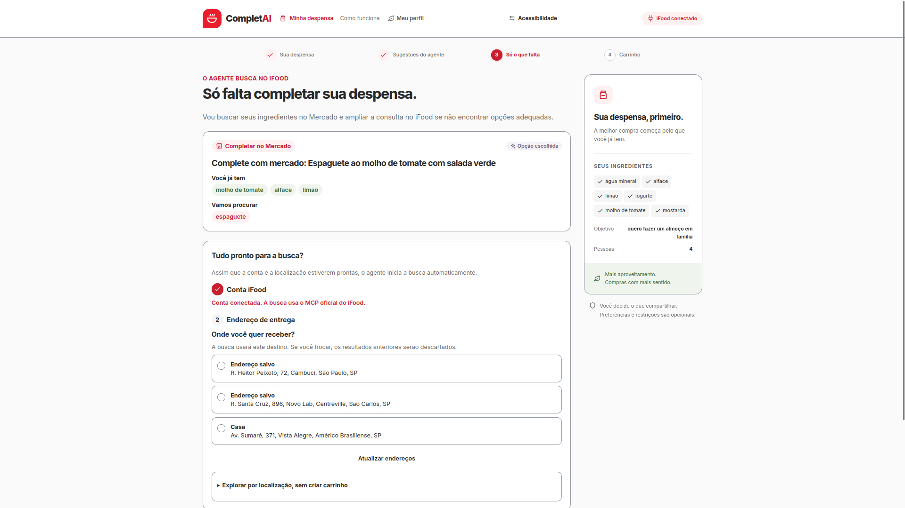
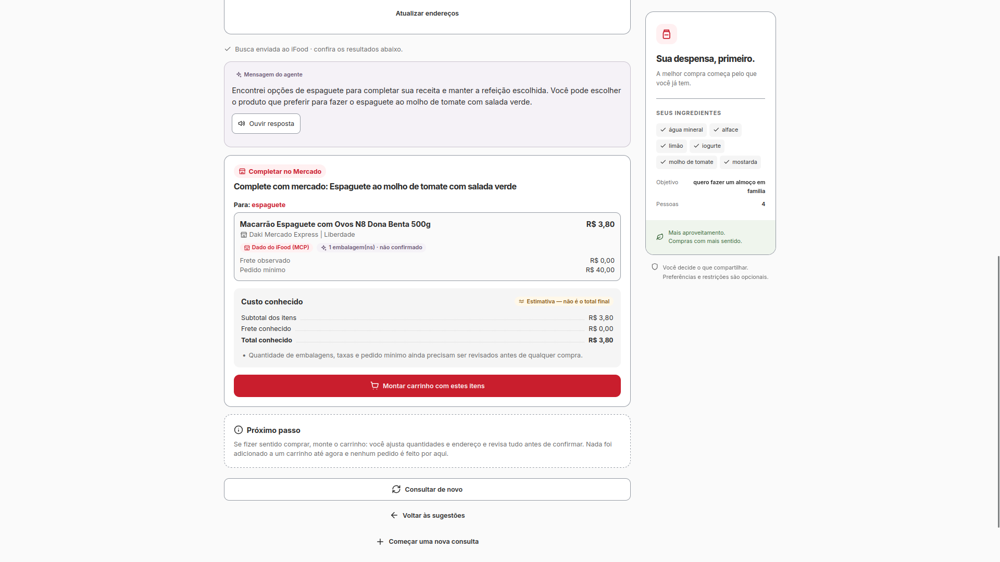
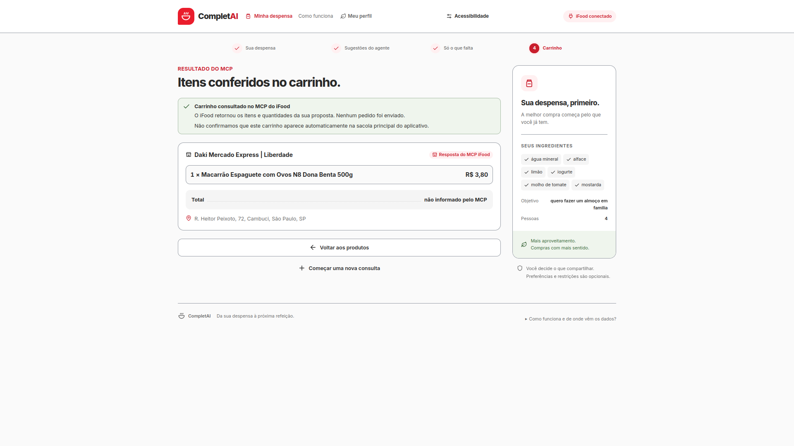

# 04. Interface visual

A CompletAI está implementada em React na branch `main`. As seis capturas abaixo foram fornecidas pela equipe e mostram a aplicação da entrada até o resultado do carrinho. Os arquivos estão incorporados ao repositório, com links para abrir em tamanho original.

## Percurso visual

| Momento | O que a tela mostra |
|---|---|
| [1. Entrada](#1-entrada) | Contexto, conexão iFood e formas de informar os alimentos |
| [2. Revisão](#2-revisão) | Alimentos reconhecidos para correção e confirmação |
| [3. Sugestões](#3-sugestões) | Preparo sem compra, complemento no iFood Mercado e conveniência |
| [4. Endereço e busca](#4-endereço-e-busca) | Opção escolhida, conta conectada e seleção do destino |
| [5. Oferta encontrada](#5-oferta-encontrada) | Produto, loja, preço observado e custos conhecidos |
| [6. Carrinho conferido](#6-carrinho-conferido) | Resultado da consulta ao carrinho após confirmação |

## 1. Entrada

A tela inicial reúne a descrição da ocasião, o acesso ao perfil e a conexão iFood. Texto, câmera e upload permitem começar de formas diferentes. O progresso no topo indica os quatro momentos da jornada, e a lateral explica o que vem depois.

Nesta captura, a conta já está conectada e o navegador não oferece ditado. A interface informa essa condição e mantém texto e foto disponíveis.

## 2. Revisão

Os alimentos reconhecidos na foto aparecem em cards editáveis. A pessoa pode corrigir nomes, remover itens ou adicionar o que faltou antes de confirmar. A aplicação trata o reconhecimento como uma hipótese e explica que a foto não comprova quantidade, validade ou segurança.

A imagem mostra a revisão dos alimentos, não a foto original. O inventário exibido nas telas seguintes já contém ajustes; as duas listas não devem ser interpretadas como uma extração automática idêntica.

## 3. Sugestões

Para o objetivo de almoço em família, a aplicação mostra três alternativas: salada com os ingredientes disponíveis, espaguete com compra complementar no iFood Mercado e refeição pronta de restaurante.

Cada card explica a escolha, os ingredientes usados e o que precisa ser comprado. Os acompanhamentos aparecem como sugestões opcionais, sem busca ou compra automática. A tela também oferece leitura em voz alta e acesso à edição de ingredientes e perfil.

## 4. Endereço e busca

A escolha do exemplo é o espaguete ao molho de tomate com salada verde. A aplicação preserva essa opção, mostra o ingrediente que será procurado e solicita o destino entre os endereços retornados pela conta conectada.

O endereço orienta a disponibilidade das ofertas. Assim que conexão e localização estão prontas, a busca começa automaticamente. Alterar o destino descarta os resultados anteriores. A alternativa de explorar por localização não habilita criação de carrinho sem endereço válido.

## 5. Oferta encontrada

O resultado apresenta espaguete de uma loja do iFood Mercado, com preço observado de R$ 3,80 e pedido mínimo de R$ 40,00. Esses valores pertencem à captura; não representam uma cotação atual.

A quantidade de embalagem aparece como ainda não confirmada. O resumo distingue custo conhecido de total final e orienta revisar quantidades e mínimo da loja. “Montar carrinho com estes itens” inicia a montagem; não envia um pedido nem substitui a confirmação posterior.

## 6. Carrinho conferido

A tela final informa que o MCP retornou os itens e quantidades da proposta. O exemplo mostra uma embalagem de espaguete e um total não informado pelo MCP.

A interface declara que nenhum pedido foi enviado e que a presença na sacola principal do aplicativo não foi confirmada. Portanto, esta captura comprova o estado exibido pela aplicação, sem demonstrar pagamento, entrega ou sincronização com o app.

## Etapas implementadas que não aparecem nas capturas

O conjunto enviado não inclui o formulário de perfil, o painel de acessibilidade nem as telas intermediárias de montagem e revisão da proposta. Esses recursos estão no código da `main`:

- **Meu perfil:** preferências, consentimento para dados sensíveis e opção de lembrar no navegador.
- **Acessibilidade:** português e inglês, temas, tamanho de texto, contraste e redução de movimento.
- **Montagem:** escolha da loja, alteração de quantidades e remoção de itens.
- **Revisão:** proposta local com endereço e valores conhecidos, antes de confirmar a criação no iFood.

O [desenho da solução](02-desenho-solucao.md) explica a ligação entre essas etapas. As imagens não mostram um fluxo de pagamento.

## Identidade e organização

O vermelho destaca a marca e as ações principais. Cards separam alternativas e produtos; títulos e mensagens de estado indicam o próximo passo. A lateral mantém o contexto visível durante a escolha. No topo, o progresso ajuda a localizar a etapa atual sem exigir uma conversa em formato de chat.

## Abrir a aplicação e os arquivos

Os comandos estão no [README principal](../../README.md). As capturas podem ser vistas diretamente nesta página do GitHub ou abertas pelos links de cada imagem. Elas foram copiadas sem edição dos arquivos enviados pela equipe; não dependem da pasta Downloads nem do ZIP para aparecer.

[Telas](../../frontend/src/steps), [componentes](../../frontend/src/components), [perfil](../../frontend/src/hooks/useUserProfile.ts) e [estilos](../../frontend/src/index.css).
