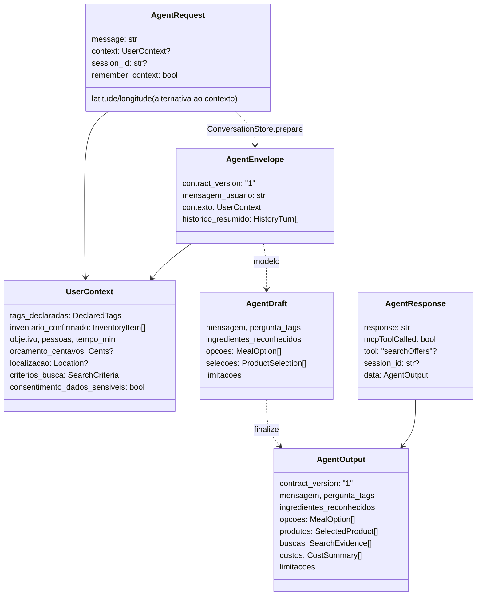

# Contratos de dados

Todos os formatos são modelos Pydantic em
[`backend/app/contracts.py`](../../../backend/app/contracts.py). O frontend
espelha esses tipos à mão em
[`frontend/src/types.ts`](../../../frontend/src/types.ts).

## Regras gerais

- **`extra="forbid"`:** todo contrato herda de `Contract` e rejeita campos
  desconhecidos. Um campo a mais no JSON resulta em `422`.
- **Espaços aparados:** `str_strip_whitespace=True`.
- **Textos curtos** (`ShortText`): de 1 a 160 caracteres.
- **Dinheiro** (`Cents`): inteiro estrito, de `0` a `100_000_000`, em centavos.
  `1.5` é rejeitado.
- **Quantidades:** `Decimal > 0`, opcionais. No JSON, chegam ao frontend como
  string.
- **Versão:** `contract_version: "1"` no envelope e na saída.

## Mapa dos contratos



## Entrada

### `AgentRequest` (corpo de `POST /api/agent/message`)

| Campo | Tipo | Regra |
|---|---|---|
| `message` | `str` | 1 a 4000 caracteres |
| `context` | `UserContext \| null` | Se presente, **substitui** o contexto inteiro da sessão |
| `session_id` | `str \| null` | 32 caracteres `[A-Za-z0-9_-]`; exige `remember_context=true` |
| `remember_context` | `bool` | Padrão `false`; com `true`, o backend guarda a conversa |
| `latitude`, `longitude` | `float \| null` | Legado; devem vir juntos e viram `context.localizacao` |

### `UserContext`

| Campo | Tipo | Observação |
|---|---|---|
| `tags_declaradas` | `DeclaredTags` | Ver abaixo |
| `inventario_confirmado` | `InventoryItem[]` | Até 80 itens |
| `objetivo` | `ShortText?` | Ex.: "jantar" |
| `pessoas` | `int?` | 1 a 100 |
| `tempo_min` | `int?` | 1 a 1440 |
| `orcamento_centavos` | `Cents?` | Também vira teto de preço por item na busca |
| `localizacao` | `Location?` | Enviada só ao MCP, nunca ao modelo |
| `criterios_busca` | `SearchCriteria` | Filtros explícitos de busca |
| `consentimento_dados_sensiveis` | `bool` | Obrigatório se houver alergias, intolerâncias ou condições |

Validação: se `alergias`, `intolerancias` ou `condicoes_saude` não estiverem
vazios e `consentimento_dados_sensiveis` for `false`, o modelo inteiro é
rejeitado ("Restrições sensíveis exigem consentimento_dados_sensiveis=true.").

### `DeclaredTags`

| Campo | Tipo |
|---|---|
| `preferencias` | Lista de `VEGETARIAN`, `VEGAN`, `ORGANIC` (até 3) |
| `alergias` | Lista de textos (até 20) |
| `intolerancias` | Lista de textos (até 20) |
| `condicoes_saude` | Lista de textos (até 20) |
| `estado` | `NOT_ASKED` · `ASKED` · `ANSWERED` · `DECLINED` |

### `InventoryItem`

| Campo | Tipo | Padrão |
|---|---|---|
| `nome` | `ShortText` | — |
| `quantidade` | `Decimal?` (> 0) | `null` |
| `unidade` | `ShortText?` | `null` |
| `origem` | `DECLARED` · `INFERRED` | `DECLARED` |
| `confirmado` | `bool` | `true` |

Só itens com `confirmado=true` contam como existentes em `finalize`.

### `SearchCriteria`

| Campo | Tipo | Vira no MCP |
|---|---|---|
| `restricoes_itens` | Lista de `ItemRestriction` | `refinements.itemRestrictions` |
| `preco_maximo_item_centavos` | `Cents?` | `refinements.maxItemPrice` (em reais) |
| `frete_maximo_centavos` | `Cents?` | `refinements.maxDeliveryFee` (em reais) |
| `ordenar_por` | `RELEVANCE` · `PRICE` · `DELIVERY_FEE` · `DELIVERY_TIME` · `DISTANCE` | `refinements.sort` |

O frontend atual **não envia** `criterios_busca`. Os filtros vêm das
preferências, das intolerâncias consentidas e do orçamento.

## Saída

### `AgentResponse`

| Campo | Significado |
|---|---|
| `response` | Igual a `data.mensagem` (compatibilidade) |
| `mcpToolCalled` | `true` se ao menos uma busca foi enviada ao MCP |
| `tool` | `"searchOffers"` quando `mcpToolCalled`, senão `null` |
| `session_id` | Preenchido só com `remember_context=true` |
| `data` | `AgentOutput` |

### `AgentOutput`

| Campo | Tipo | Procedência |
|---|---|---|
| `mensagem` | `str` | IA (ou mensagem determinística em falha/vazio) |
| `pergunta_tags` | `bool` | Ajustado pelo backend |
| `contexto_reconhecido` | `RecognizedContext` | `INFERRED`, `confirmado=false` |
| `ingredientes_reconhecidos` | `RecognizedIngredient[]` | `INFERRED`, `confirmado=false` |
| `opcoes` | `MealOption[]` (até 3) | `INFERRED` |
| `produtos` | `SelectedProduct[]` | `MCP` (quantidade `INFERRED`) |
| `buscas` | `SearchEvidence[]` | Registro do backend |
| `custos` | `CostSummary[]` | `ESTIMATED` |
| `limitacoes` | `str[]` | Backend + IA, sem duplicatas |

### `RecognizedContext`

Detalhes do pedido que o agente extraiu do texto, para revisão.

| Campo | Tipo |
|---|---|
| `objetivo` | `ShortText?` |
| `pessoas` | `int?` (1 a 100) |
| `tempo_min` | `int?` (1 a 1440) |
| `orcamento_centavos` | `Cents?` |
| `provenance` | `"INFERRED"` (fixo) |
| `confirmado` | `false` (fixo) |

Esses valores **não** entram nos filtros nem nos custos. Só passam a valer quando
o frontend os reenvia dentro de `UserContext`, depois da confirmação. Na captura
por foto, ficam vazios se a pessoa não escreveu texto. Campos extras (como
`alergias`) são rejeitados.

### `ImageParseRequest` (corpo de `POST /api/context/parse-image`)

Definido em `backend/app/vision.py`.

| Campo | Regra |
|---|---|
| `image_data_url` | Data URL base64 de JPEG, PNG ou WebP; o arquivo pode ter até 5 MB |
| `message` | Texto opcional, até 4000 caracteres |

A resposta é o mesmo `AgentResponse` da captura por texto.

### `MealOption`

`titulo`, `estrategia`, `usa` (itens do inventário), `faltantes`,
`justificativa` (até 1500 caracteres), `provenance="INFERRED"`.

### `SelectedProduct`

Herda de `ObservedProduct`:

| Campo | Origem |
|---|---|
| `referencia` | `offer_N` local |
| `item_id`, `merchant_id` | MCP (`itemId`, `merchant.merchantId`) |
| `nome_observado` | MCP (`itemName`) |
| `loja_observada` | MCP (`merchant.merchantName`) |
| `preco_observado_centavos` | MCP: promocional se ≤ preço base, senão base |
| `frete_observado_centavos` | MCP: `promotionalFee`, senão `fee` |
| `minimo_pedido_centavos` | MCP (`minimumOrderAmount`) |
| `provenance` | `"MCP"` |

Mais os campos da seleção: `faltante`, `opcao_indice`, `quantidade_embalagens`,
`quantidade_provenance="INFERRED"` e `quantidade_confirmada=false`.

### `CostSummary`

| Campo | Significado |
|---|---|
| `opcao_indice` | Opção a que se refere |
| `subtotal_conhecido_centavos` | Σ preço × embalagens (itens sem preço contam 0) |
| `taxas_conhecidas_centavos` | Frete, uma vez por loja |
| `total_conhecido_centavos` | Subtotal + frete conhecido |
| `precos_completos` | Todos os itens têm preço |
| `fretes_completos` | Todas as lojas têm frete consistente |
| `total_final` | Sempre `false` |
| `orcamento_status` | `over` · `unknown_total` · `not_applicable` |

Não existe status "dentro do orçamento": sem o total final, o sistema não afirma
que cabe.

### `SearchEvidence`

`query`, `restricoes_aplicadas`, `status` (`success` · `empty` · `error`) e
`quantidade_resultados`.

## Procedência

| Valor | Na interface | Quem produz |
|---|---|---|
| `DECLARED` | Você informou | A pessoa (digitou ou corrigiu) |
| `INFERRED` | Sugerido pela IA | O modelo |
| `MCP` | Dado do iFood (MCP) | `observe_products` |
| `ESTIMATED` | Estimativa | `calculate_costs` |

## Exemplo completo

Requisição de busca no Mercado:

```json
{
  "message": "Escolhi esta opção: {...}. Busque no iFood Mercado apenas os ingredientes faltantes dela.",
  "remember_context": false,
  "context": {
    "tags_declaradas": { "preferencias": ["VEGETARIAN"], "alergias": [], "intolerancias": [], "condicoes_saude": [], "estado": "ANSWERED" },
    "consentimento_dados_sensiveis": false,
    "inventario_confirmado": [
      { "nome": "arroz", "quantidade": null, "unidade": null, "origem": "INFERRED", "confirmado": true },
      { "nome": "ovos", "quantidade": "6", "unidade": "un", "origem": "DECLARED", "confirmado": true }
    ],
    "objetivo": "jantar",
    "pessoas": 2,
    "tempo_min": 30,
    "orcamento_centavos": 3500,
    "localizacao": { "latitude": -22.0087, "longitude": -47.8909 }
  }
}
```

Resposta (resumida, com dados sintéticos):

```json
{
  "response": "Para completar o preparo, separei opções para o que falta.",
  "mcpToolCalled": true,
  "tool": "searchOffers",
  "session_id": null,
  "data": {
    "contract_version": "1",
    "mensagem": "Para completar o preparo, separei opções para o que falta.",
    "pergunta_tags": false,
    "ingredientes_reconhecidos": [],
    "opcoes": [{ "titulo": "Arroz de forno com legumes", "estrategia": "COMPLETE_WITH_MARKET",
                 "usa": ["arroz", "ovos"], "faltantes": ["cebola"], "justificativa": "...", "provenance": "INFERRED" }],
    "produtos": [{ "referencia": "offer_1", "item_id": "synthetic-item-1", "merchant_id": "synthetic-store",
                   "nome_observado": "Produto fictício", "loja_observada": "Loja fictícia",
                   "preco_observado_centavos": 499, "frete_observado_centavos": 450, "minimo_pedido_centavos": null,
                   "provenance": "MCP", "faltante": "cebola", "opcao_indice": 0, "quantidade_embalagens": 1,
                   "quantidade_provenance": "INFERRED", "quantidade_confirmada": false }],
    "buscas": [{ "query": "cebola", "restricoes_aplicadas": ["VEGETARIAN"], "status": "success", "quantidade_resultados": 1 }],
    "custos": [{ "opcao_indice": 0, "subtotal_conhecido_centavos": 499, "taxas_conhecidas_centavos": 450,
                 "total_conhecido_centavos": 949, "precos_completos": true, "fretes_completos": true,
                 "total_final": false, "provenance": "ESTIMATED", "orcamento_status": "unknown_total" }],
    "limitacoes": ["Preços são observações do MCP nesta execução, não cotação final. ..."]
  }
}
```

## JSON Schemas

`python backend/scripts/export_contracts.py` gera em
[`docs/contracts/`](../../contracts/):

| Arquivo | Modelo |
|---|---|
| `agent-request.schema.json` | `AgentRequest` |
| `agent-response.schema.json` | `AgentResponse` |
| `agent-envelope.schema.json` | `AgentEnvelope` |
| `agent-output.schema.json` | `AgentOutput` |
| `image-request.schema.json` | `ImageParseRequest` |

O OpenAPI completo fica em `http://localhost:8000/docs` com o backend rodando.

## Divergências entre frontend e backend

| Ponto | Frontend (`types.ts`) | Backend (`contracts.py`) |
|---|---|---|
| `AgentOutput.contexto_reconhecido` | Opcional (`?`) | Sempre presente, com padrão vazio |
| `UserContext.criterios_busca` | Ausente | Opcional, com padrão |
| `AgentRequest.remember_context` | Tipado como `false` | `bool` |

## Veja também

- [Saída estruturada do agente](../04-agente/saida-estruturada.md)
- [Regras de negócio](../03-backend/regras-de-negocio.md)
