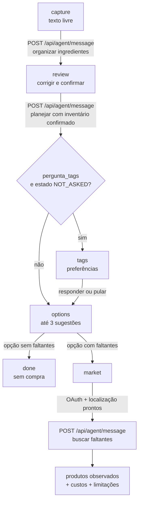
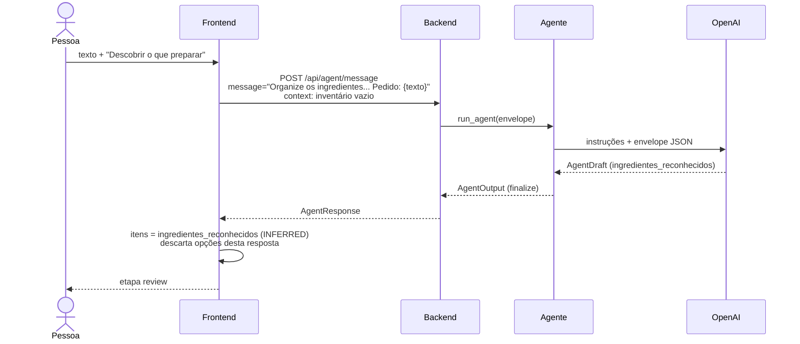
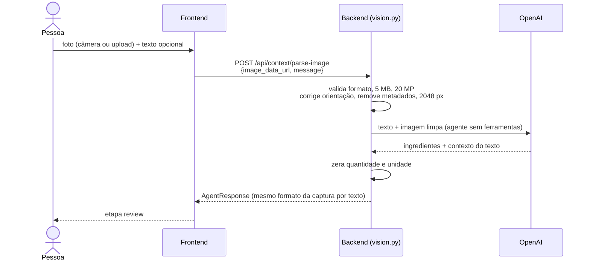
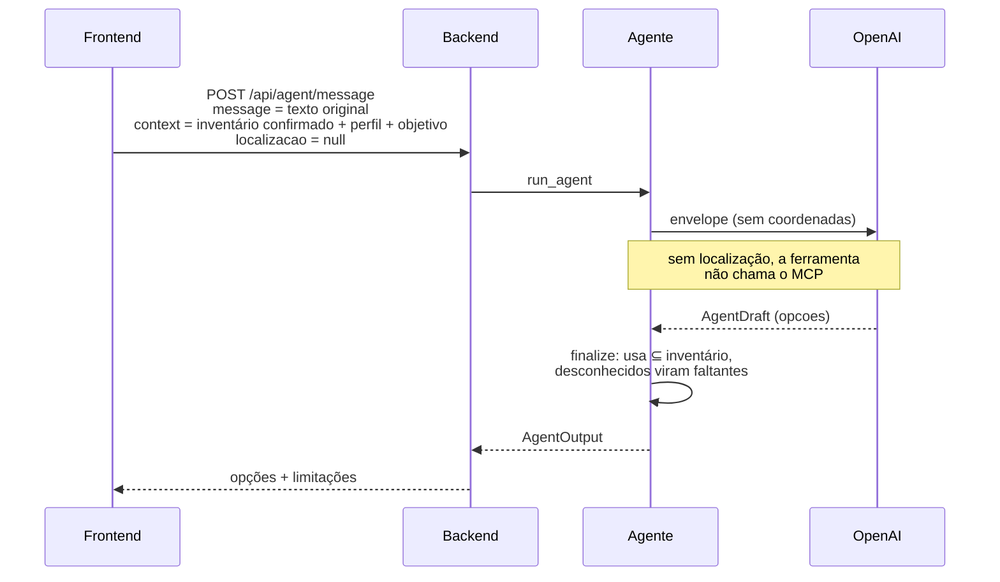
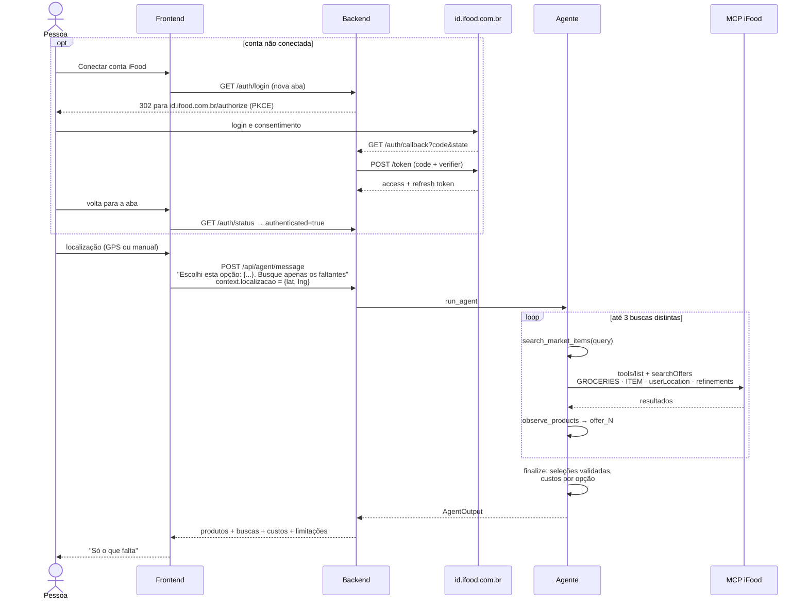

# Fluxo da aplicação

O fluxo principal tem três passos visíveis na barra de progresso ("Sua
despensa", "Sugestões do agente", "Só o que falta") e seis etapas internas no
frontend: `capture`, `review`, `tags`, `options`, `market` e `done`.

## Visão geral

Cada chamada do frontend é **stateless**: ele sempre manda `remember_context=false`
e o contexto completo. O backend não guarda nada entre as etapas.

## 1. Captura

A pessoa escreve o que tem e o que quer, por exemplo:

> Tenho arroz, ovos, tomate e cenoura. Quero preparar um jantar para duas
> pessoas, tenho 30 minutos e posso gastar até R$ 35.

- O frontend pede explicitamente "ainda não planeje refeições nem busque
  produtos".
- Opções que vierem nessa resposta são descartadas, porque partem de um
  inventário vazio.
- O agente também devolve `contexto_reconhecido` (objetivo, pessoas, tempo e
  orçamento citados no texto), que preenche a seção "Seu pedido" para revisão.

### Captura com foto

- Com foto anexada, o frontend usa só essa rota, mesmo que também haja texto; o
  texto vai junto como `message`.
- A foto não é guardada nem reenviada: o planejamento seguinte usa só os
  ingredientes confirmados. Detalhes em
  [Reconhecimento de imagem](../04-agente/reconhecimento-de-imagem.md).

## 2. Revisão

A pessoa vê os ingredientes como *Reconhecido pela IA* e pode:

- Corrigir nome, quantidade e unidade. Qualquer edição muda a origem para
  `DECLARED`.
- Remover e adicionar itens (sem duplicatas, até 80).
- Conferir objetivo, pessoas, tempo e orçamento (seção "Seu pedido"), que chegam
  preenchidos com o que o agente entendeu do texto.
- Informar preferências e, com consentimento, restrições sensíveis.

Ao confirmar, o frontend marca as tags como `ANSWERED` e chama o planejamento.

## 3. Planejamento

- `finalize` garante que `usa` só contém itens confirmados. Um ingrediente que o
  modelo "achou" que existe vira faltante. Uma opção `USE_WHAT_I_HAVE` com
  faltantes é rebaixada para `COMPLETE_WITH_MARKET`.
- Se o modelo pedir `pergunta_tags` e o estado for `NOT_ASKED`, a interface vai
  para a etapa `tags`. Como a revisão já marca `ANSWERED`, isso raramente
  acontece no caminho principal; o perfil pode ser editado pelo botão "Perfil".

## 4. Escolha

- **Opção sem faltantes:** vai para `done`, com a mensagem "Nenhuma compra
  necessária". Nada é chamado.
- **Opção com faltantes:** vai para `market`, e o frontend reconsulta
  `/auth/status`.

## 5. Busca no Mercado

- A busca começa **sozinha, uma única vez**, assim que conta e localização estão
  prontas. Depois de um erro, só repete por ação explícita.
- As coordenadas vão **só para o MCP**. O prompt do modelo recebe apenas
  `localizacao_disponivel: true`.
- Os filtros (`itemRestrictions`, `maxItemPrice`, `maxDeliveryFee`, `sort`) são
  montados pelo backend a partir do contexto, não pelo modelo.

## 6. Resultado

Para cada faltante, a tela mostra os produtos selecionados com:

- Nome, loja e preço observados (procedência **MCP**).
- Quantidade de embalagens (procedência **IA**, não confirmada).
- Frete observado e pedido mínimo.
- Custo conhecido da opção (procedência **Estimativa**), separado em subtotal e
  frete, com aviso de que não é o total final.
- Registro das consultas (`searchOffers`, termo, status e filtros).
- Limitações informadas pelo sistema.
- Aviso de que **nada foi adicionado a um carrinho**.

## Casos de borda tratados

| Situação | Comportamento |
|---|---|
| Todas as buscas falharam | Mensagem determinística: "Não foi possível concluir a consulta ao iFood..." |
| Todas as buscas vazias | Mensagem determinística: "Nenhum produto foi encontrado..." |
| Parte falhou | Aviso "Parte das consultas falhou" |
| Produtos encontrados mas não associados | Aviso "Nenhum produto selecionado" |
| Sem login no iFood | A ferramenta devolve `AUTH_REQUIRED`, e a rota responde `401` |
| Sem localização | A ferramenta devolve `MISSING_LOCATION` sem chamar o MCP |
| O modelo não chamou a busca | Aviso "O iFood não foi consultado nesta resposta" |
| Custo acima do orçamento | Aviso "Acima do orçamento" com o valor conhecido |

## Veja também

- [Fluxo de telas](../05-frontend/fluxo-de-telas.md)
- [Ciclo de execução do agente](../04-agente/ciclo-de-execucao.md)
- [Autenticação OAuth](../03-backend/autenticacao-oauth.md)
