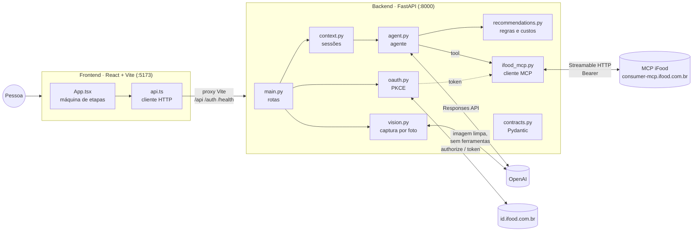
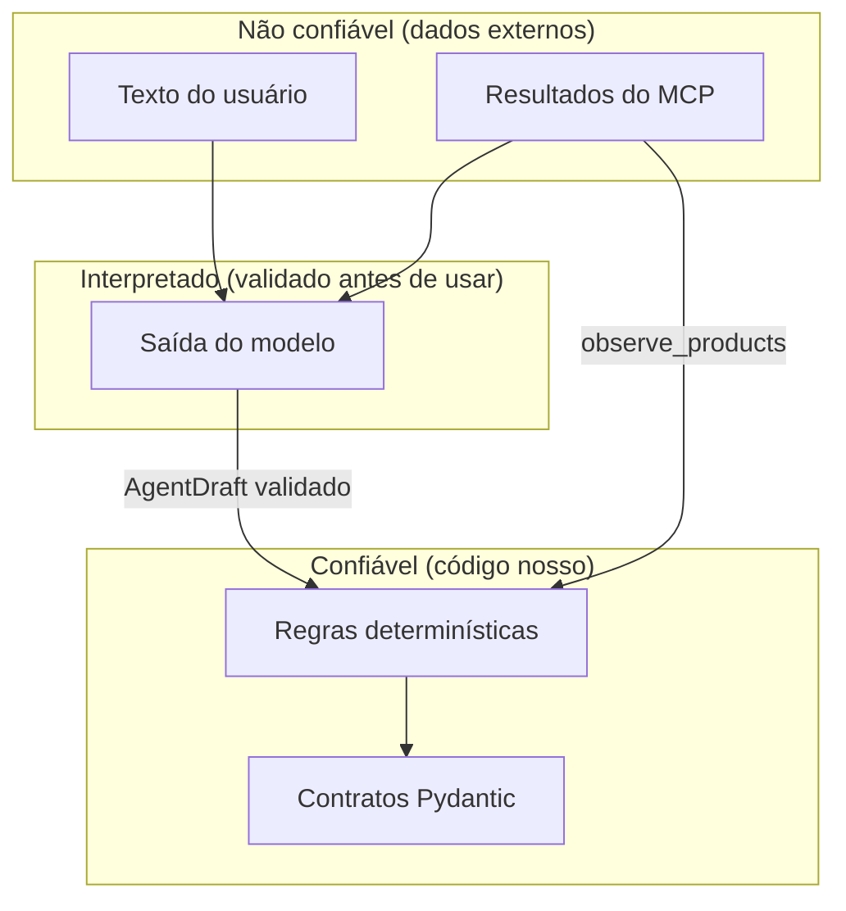

# Visão geral da arquitetura

## Princípio

> **A IA interpreta, planeja e explica. O backend valida, calcula e controla.
> O MCP fornece as capacidades comerciais disponíveis.**

## Componentes

| Componente | Responsabilidade | Não faz |
|---|---|---|
| **Frontend** | Coleta contexto, mostra etapas, confirma dados, exibe procedência | Não guarda credenciais, não chama OpenAI nem MCP diretamente |
| **Rotas** (`main.py`) | Valida entrada, orquestra execução, traduz erros em HTTP | Não contém regra de negócio |
| **Sessões** (`context.py`) | Guarda contexto e histórico quando pedido; aplica revogação | Não persiste em disco |
| **Agente** (`agent.py`) | Interpreta, planeja, decide quando buscar, explica | Não escreve preços, IDs nem totais; não executa compras |
| **Captura por foto** (`vision.py`) | Valida e limpa a imagem em memória; um agente sem ferramentas lista ingredientes para revisão | Não busca, não planeja, não guarda a foto, não infere quantidades |
| **Regras** (`recommendations.py`) | Monta filtros, extrai evidências, calcula custos, sanitiza a saída | Não chama o modelo |
| **Cliente MCP** (`ifood_mcp.py`) | Conecta, valida argumentos pelo schema, chama `searchOffers`, faz retry de transporte | Não interpreta produtos |
| **OAuth** (`oauth.py`) | PKCE, troca e refresh de tokens | Não expõe tokens ao frontend nem ao modelo |
| **Contratos** (`contracts.py`) | Define e valida todos os formatos de dados | — |

## Camadas lógicas

| Camada | No código | Papel |
|---|---|---|
| Entrada | `CaptureStep`, `PhotoInput`, `vision.py` | Texto e foto viram a mesma lista de ingredientes para revisão |
| Contexto | `UserContext`, `ConversationStore` | Inventário, perfil, orçamento, tempo, localização |
| Agêntica | `run_agent`, `AGENT_INSTRUCTIONS` | Interpretação e planejamento |
| Determinística | `recommendations.py` | Validação, filtros, custos, limites |
| Integração comercial | `ifood_mcp.py`, `oauth.py` | Acesso ao MCP oficial |
| Apresentação | Etapas do frontend | Cards, procedência, limitações |

## Modelo de processo

- **Um único processo backend** (uvicorn). O agente é uma **biblioteca
  stateless** chamada dentro da requisição; não existe um serviço de agente
  separado.
- **Estado em memória:** tokens OAuth, tentativas de login e sessões de conversa
  vivem em `app.state` e somem ao reiniciar.
- **Execuções serializadas:** a rota do agente segura `ConversationStore.lock`
  durante toda a execução. Duas requisições simultâneas ao agente rodam uma após
  a outra.
- **Uma conexão MCP por busca:** cada chamada a `searchOffers` abre uma conexão
  Streamable HTTP, faz `tools/list`, valida e chama a ferramenta.

## Stack

| Camada | Tecnologia | Versão (requisitos) |
|---|---|---|
| Frontend | React, React DOM | `^18.3.1` |
| Build | Vite, TypeScript | `^5.4.0`, `^5.5.3` |
| Estilo | Tailwind CSS (plugin Vite) | `^4.0.0` |
| Backend | FastAPI, Uvicorn | `>=0.115,<1`, `>=0.34,<1` |
| Contratos | Pydantic (via FastAPI) | v2 |
| Agente | `openai-agents` | `>=0.24,<0.25` |
| MCP | `mcp` (SDK Python oficial) | `>=2.3,<3` |
| HTTP | `httpx2` | `>=2.13,<3` |
| Validação de schema | `jsonschema` (Draft 2020-12) | `>=4.23,<5` |
| Imagens | `pillow` | `>=12,<14` |
| Modelo padrão | `gpt-4.1-mini` | configurável por `OPENAI_MODEL` |

## Fronteiras de confiança

- O texto do usuário e os resultados do MCP são **dados**, não instruções. O
  prompt diz isso ao modelo explicitamente.
- A saída do modelo passa por `AgentDraft.model_validate` e depois por
  `finalize`, que descarta tudo que não tem evidência.
- Dados comerciais exibidos vêm de `observe_products`, nunca do texto do modelo.

## Veja também

- [Fluxo da aplicação](fluxo-da-aplicacao.md)
- [Decisões arquiteturais](decisoes-arquiteturais.md)
- [Visão geral do backend](../03-backend/README.md)
