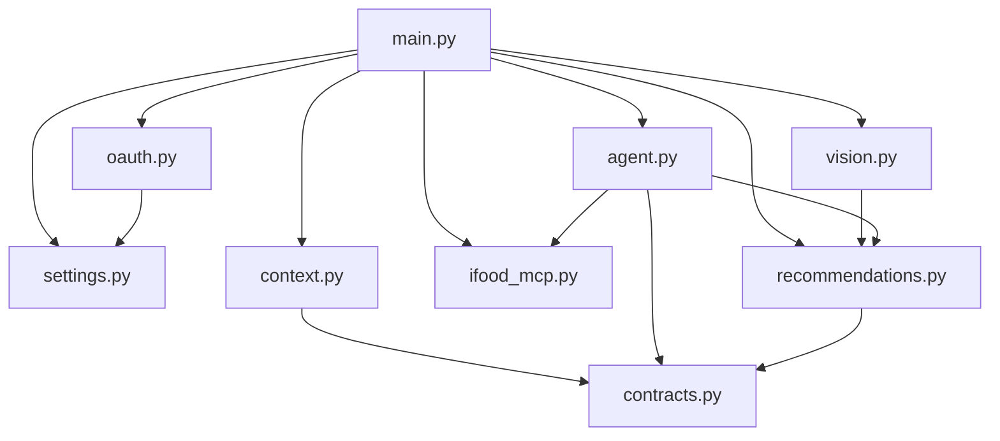

# Backend

API em **Python + FastAPI** que guarda o contexto, roda o agente, autentica no
iFood e consulta o MCP. Código em [`backend/`](../../../backend/).

## Estrutura de pastas

```
backend/
├── .env.example              modelo das variáveis de ambiente
├── requirements.txt          dependências Python
├── README.md                 guia rápido de execução e contrato
├── app/
│   ├── __init__.py
│   ├── main.py               app FastAPI, rotas e tradução de erros
│   ├── settings.py           leitura das variáveis de ambiente
│   ├── contracts.py          todos os modelos Pydantic
│   ├── context.py            ConversationStore (sessões em memória)
│   ├── agent.py              agente, prompt e ferramenta de busca
│   ├── recommendations.py    filtros, evidências, custos e sanitização
│   ├── vision.py             captura por foto: validação da imagem e agente de extração
│   ├── ifood_mcp.py          cliente MCP (Streamable HTTP)
│   └── oauth.py              OAuth 2.0 + PKCE do iFood
├── scripts/
│   └── export_contracts.py   gera docs/contracts/*.schema.json
└── tests/
    ├── test_agent.py         21 testes (regras, agente, API, MCP, regressão)
    ├── test_vision.py        7 testes (validação da imagem, agente de captura, rota)
    └── fixtures/
        └── search_offers_schema.json   schema real do searchOffers
```

## Mapa dos módulos



| Módulo | Responsabilidade | Página |
|---|---|---|
| `main.py` | Rotas, ciclo de vida, CORS, códigos HTTP | [Referência da API](api-referencia.md) |
| `settings.py` | `Settings.from_env()` e validação das credenciais OAuth | [Configuração](configuracao.md) |
| `contracts.py` | Modelos de entrada, saída e evidência | [Contratos de dados](../02-arquitetura/contratos-de-dados.md) |
| `context.py` | Sessões, histórico, revogação de consentimento | [Contexto e sessões](contexto-e-sessoes.md) |
| `agent.py` | Prompt, ferramenta e execução do agente | [Agente](../04-agente/README.md) |
| `recommendations.py` | Regras determinísticas | [Regras de negócio](regras-de-negocio.md) |
| `vision.py` | Validação e limpeza da foto; agente de extração sem ferramentas | [Reconhecimento de imagem](../04-agente/reconhecimento-de-imagem.md) |
| `ifood_mcp.py` | Conexão e chamadas ao MCP | [Integração MCP](integracao-mcp.md) |
| `oauth.py` | Login do consumidor e tokens | [Autenticação OAuth](autenticacao-oauth.md) |

## Ciclo de vida da aplicação

`main.py` usa um `lifespan` que cria, na inicialização:

- `app.state.ifood_oauth = IfoodOAuth()`: tentativas de login e tokens.
- `app.state.conversations = ConversationStore()`: sessões de conversa.

Tudo é memória do processo. **Reiniciar o backend exige um novo login no iFood.**
Por isso não use `--reload` durante a demonstração.

## Caminho de uma requisição ao agente

1. FastAPI valida o corpo como `AgentRequest` (`422` se inválido).
2. Sem `OPENAI_API_KEY`, responde `503`.
3. Adquire `ConversationStore.lock` (serializa as execuções).
4. `store.prepare(payload)` monta o `AgentEnvelope` (e aplica a revogação, se
   houver).
5. `run_agent(...)` com timeout de **90 s**.
6. Converte erros: `HTTPException` passa adiante, timeout vira `504` e o resto
   vira `502`.
7. `store.commit(...)` grava a sessão, se `remember_context=true`.
8. Devolve `AgentResponse`.

## Executar

```bash
cd backend
python -m venv .venv
source .venv/bin/activate        # Windows: .venv\Scripts\activate
pip install -r requirements.txt
cp .env.example .env             # preencher as credenciais
uvicorn app.main:app --env-file .env --host 127.0.0.1 --port 8000 --no-access-log
```

Detalhes em [Como rodar](../06-operacao/como-rodar.md).

## Veja também

- [Referência da API](api-referencia.md)
- [Testes](testes.md)
- [`backend/README.md`](../../../backend/README.md)
