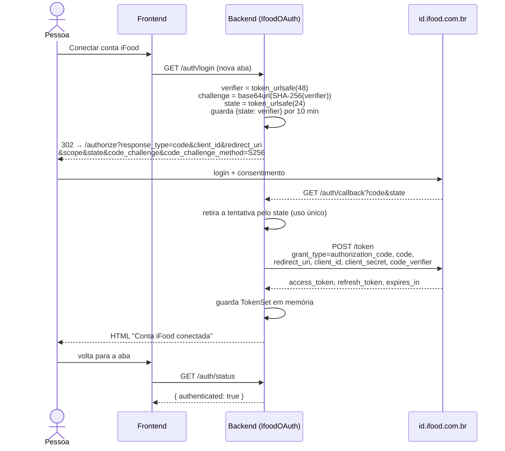
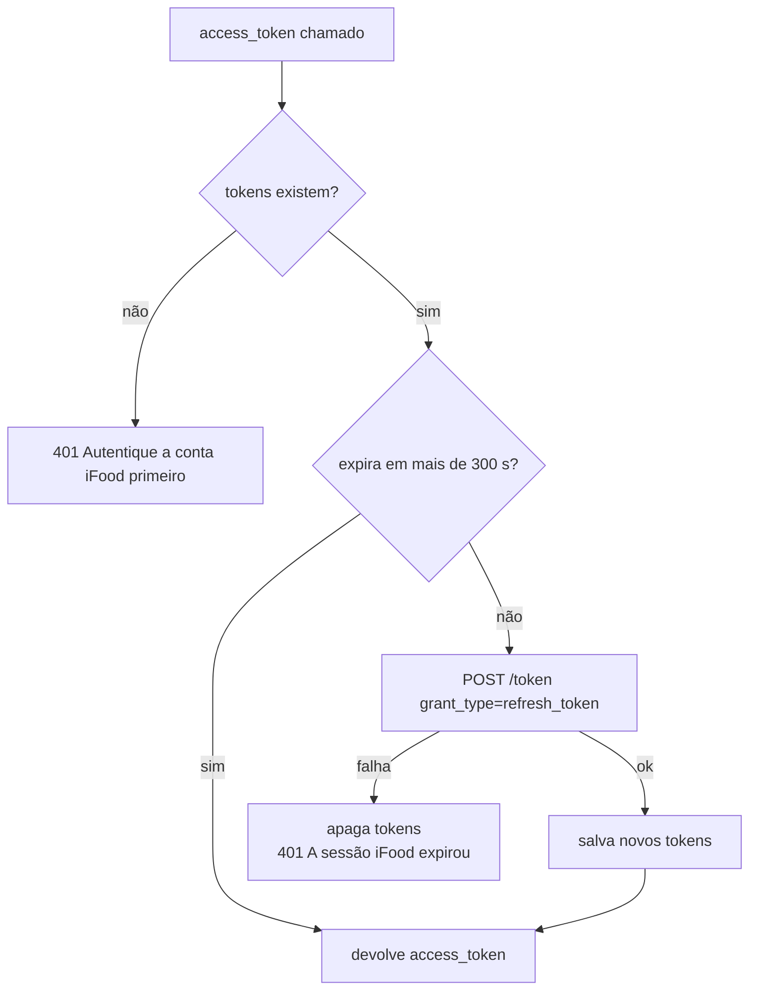

# Autenticação OAuth

O MCP do iFood age **em nome de um consumidor**. Para isso, o backend usa o fluxo
**OAuth 2.0 Authorization Code com PKCE** contra `id.ifood.com.br`. Código em
[`backend/app/oauth.py`](../../../backend/app/oauth.py).

## Endpoints do provedor

| Uso | URL |
|---|---|
| Autorização | `https://id.ifood.com.br/authorize` |
| Token | `https://id.ifood.com.br/token` |

## Fluxo

## Detalhes da implementação

### Início (`authorization_url`)

- Valida que `client_id` e `client_secret` existem (`RuntimeError` se não, que a
  rota converte em `503`).
- Limpa tentativas expiradas antes de criar outra.
- Cada tentativa vale **600 s** (`ATTEMPT_TTL_SECONDS`).

### Callback (`finish_authorization`)

- O `state` é retirado do dicionário (`pop`), então **cada `state` só serve uma
  vez**.
- `state` desconhecido ou expirado responde `400`.
- A resposta do token **precisa** ter `access_token` e `refresh_token`. Sem
  `refresh_token`, a troca é tratada como falha (`502`).
- `expires_in` padrão: 3600 s.
- Erros nunca repassam o corpo da resposta, a URL ou o código.

### Uso do token (`access_token`)

- Um `asyncio.Lock` evita refresh duplicado em chamadas concorrentes.
- O token só é pedido **quando o agente realmente vai buscar**. Ideias sem
  compra não exigem login (há teste para isso: `test_no_purchase_requires_no_ifood_token`).

## Escopos

O padrão é `mcp.discovery.search.read`, o escopo verificado para `searchOffers`.
O portal aprovou também escopos de usuário, carrinho, pagamento e pedidos, mas
o código não os pede nem os usa.

Com esse escopo, o `tools/list` real devolveu `searchOffers`, `listVouchers` e
`setVoucher`. Ver o [feedback sobre o MCP](../../entregaveis/06-feedback-mcp.md).

## Limitações

| Limitação | Consequência |
|---|---|
| Tokens globais no processo | Um usuário por vez; quem acessar o backend usa a conta conectada |
| Tokens só em memória | Reiniciar o backend exige novo login |
| `/auth/status` não testa o token | Pode dizer `true` com um token que vai falhar no refresh |
| Callback fixo em `localhost:8000` | A página final fica no backend, não no frontend |

## Veja também

- [Integração MCP](integracao-mcp.md)
- [Segurança e privacidade](../02-arquitetura/seguranca-e-privacidade.md)
