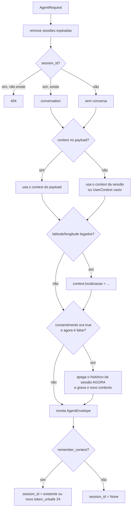

# Contexto e sessões

O backend é dono do contexto. O agente não tem memória: recebe tudo de que
precisa num `AgentEnvelope` a cada execução. Código em
[`backend/app/context.py`](../../../backend/app/context.py).

## `ConversationStore`

| Propriedade | Valor |
|---|---|
| Armazenamento | `OrderedDict[str, Conversation]` em memória |
| TTL | 1800 s, **deslizante** (renovado a cada turno gravado) |
| Capacidade | 100 sessões; acima disso, descarta a menos recente (LRU) |
| Histórico | Últimos 12 turnos (6 trocas) |
| Concorrência | `asyncio.Lock`, segurado pela rota durante toda a execução do agente |

Cada `Conversation` guarda `context` (`UserContext`), `history`
(`HistoryTurn[]`) e `expires_at`.

## `prepare(payload)` — antes do agente

Pontos importantes:

- **Substituição, não merge:** um `context` enviado substitui o anterior por
  inteiro.
- **Revogação imediata:** quando o consentimento a dados sensíveis é retirado, o
  histórico é apagado **dentro do `prepare`**, antes de chamar o modelo. Se o
  modelo falhar em seguida, a exclusão já aconteceu
  (`test_revocation_clears_sensitive_history_before_next_model_run`).
- O `session_id` gerado tem 32 caracteres, compatível com o padrão
  `^[A-Za-z0-9_-]{32}$`.

## `commit(session_id, envelope, output)` — depois do agente

Só roda se a execução terminou bem **e** `remember_context=true`.

1. Copia o contexto do envelope.
2. Se o agente marcou `pergunta_tags` e o estado era `NOT_ASKED`, muda para
   `ASKED`. Assim, a pergunta sobre preferências nunca se repete.
3. Acrescenta dois turnos ao histórico:
   - `usuario`: a mensagem.
   - `agente`: o `AgentOutput` em JSON, **sem** `produtos`, `custos` e
     `buscas`.
4. Mantém só os 12 últimos turnos.
5. Renova o TTL e move a sessão para o fim (mais recente).
6. Descarta as sessões mais antigas acima de 100.

Produtos, preços e buscas ficam fora do histórico de propósito: o agente não deve
usar preços antigos como evidência atual (o prompt também diz isso).

## `delete(session_id)`

Remove a sessão. Responde `404` se ela não existir. Exposto em
`DELETE /api/agent/sessions/{session_id}`.

## O frontend usa sessões?

**Não.** O frontend sempre manda `remember_context=false` e reenvia o contexto
completo. O controle do estado das tags (`NOT_ASKED` → `ASKED` → `ANSWERED`) é
feito no próprio frontend. As sessões existem para clientes que preferem
conversar por turnos (por exemplo, testes pela rota `/agent/test`).

## Veja também

- [Ciclo de execução do agente](../04-agente/ciclo-de-execucao.md)
- [Segurança e privacidade](../02-arquitetura/seguranca-e-privacidade.md)
