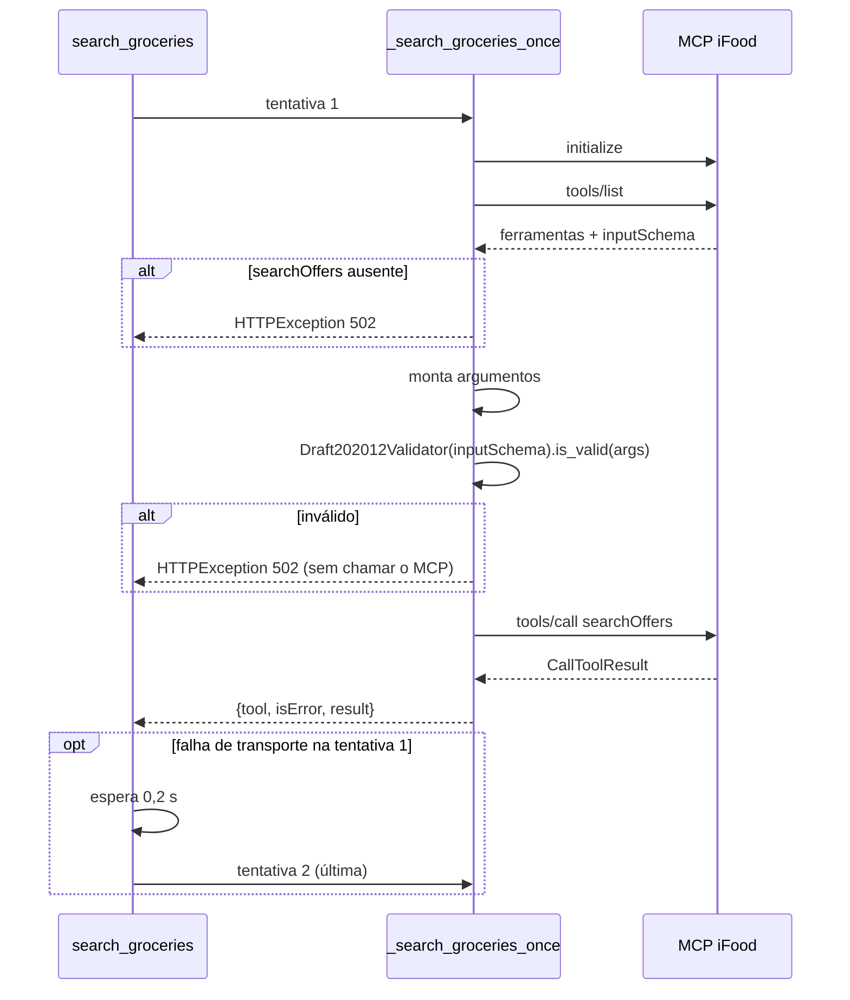

# Integração MCP

Cliente do MCP oficial do iFood, em
[`backend/app/ifood_mcp.py`](../../../backend/app/ifood_mcp.py).

## Conexão

| Item | Valor |
|---|---|
| Gateway | `IFOOD_MCP_URL` (padrão `https://consumer-mcp.ifood.com.br/marketplace`) |
| Transporte | Streamable HTTP (`mcp.client.streamable_http.streamable_http_client`) |
| Cliente | `mcp.Client` (SDK Python oficial) |
| HTTP | `httpx2.AsyncClient` com `Authorization: Bearer <access_token>` |
| Timeouts | 30 s geral, 60 s de leitura |

`_connected_client` cria o cliente HTTP e o transporte. **Cada operação abre e
fecha sua própria conexão**; não há pool nem sessão MCP reaproveitada.

## Operações

### `list_tools(mcp_url, access_token)`

Usada por `GET /api/integration/tools`. Devolve `name`, `description` e
`inputSchema` de cada ferramenta. Qualquer falha vira `502` ("Não foi possível
consultar tools/list no MCP do iFood.").

### `search_groceries(...)`

Única operação de negócio. É chamada pela ferramenta do agente e por
`POST /mcp/test-search`.



#### Argumentos enviados

```json
{
  "query": "tomate",
  "resultKind": "ITEM",
  "merchantType": "GROCERIES",
  "userLocation": { "latitude": -22.0087, "longitude": -47.8909 },
  "pageSize": 5,
  "refinements": {
    "sort": "RELEVANCE",
    "itemRestrictions": ["VEGAN"],
    "maxItemPrice": 20.0,
    "maxDeliveryFee": 8.0
  }
}
```

- `resultKind=ITEM` faz a busca devolver produtos (o padrão do MCP é
  `MERCHANT`).
- `merchantType=GROCERIES` restringe ao iFood Mercado.
- `refinements` vem de `build_refinements` (ver
  [Regras de negócio](regras-de-negocio.md#build_refinements)) e só é incluído se
  não estiver vazio.

#### Validação pelo schema

Antes de cada `tools/call`, os argumentos são validados contra o `inputSchema`
**anunciado pelo servidor naquela conexão**. Foi assim que se descobriu que o
nome real do filtro é `itemRestrictions`, e não `dietary` como no guia.

O schema coletado em 17/10/2026 está em
`backend/tests/fixtures/search_offers_schema.json`.

#### Formato do retorno

```json
{ "tool": "searchOffers", "isError": false, "result": <payload> }
```

`_tool_result_payload` devolve `structured_content` quando existe. Caso
contrário, devolve a lista de blocos de texto (`[{"type": "text", "text": "..."}]`).
`observe_products` sabe ler os dois formatos.

#### Retry

`_transient` considera transitórios:

- `httpx2.TransportError`
- `TimeoutError`
- `ConnectionError`
- `BaseExceptionGroup` em que **todas** as exceções são transitórias

Só nesse caso há uma segunda tentativa. Schema inválido, ferramenta ausente e
erros de negócio não são repetidos (`test_only_transport_failures_are_retried_once`).

#### Erros

| Situação | Resultado |
|---|---|
| `searchOffers` não anunciada | `502` "O MCP conectado não anunciou a ferramenta searchOffers." |
| Argumentos fora do schema | `502` "Os argumentos não correspondem ao schema anunciado de searchOffers." |
| Qualquer outra exceção | `502` "A chamada searchOffers ao MCP do iFood falhou." (com log do tipo da exceção, sem dados) |
| Erro de negócio no payload | Volta como `isError` ou `errors` no `result`; quem interpreta é `observe_products` |

### `search_groceries_text(...)`

Atalho legado que serializa o resultado em JSON. Não é usado pelo fluxo atual.

## Ferramentas do MCP e uso no projeto

| Domínio | Ferramentas documentadas | Usadas |
|---|---|---|
| User | `getUser`, `listAddresses`, `createAddress` | Nenhuma |
| Offer Discovery | `searchOffers`, `browseOffers`, `getRecommendations`, `listItemTaxonomy`, `getMerchant`, `getItem` | **`searchOffers`** |
| Cart | `createCart`, `getCart`, `addItemToCart`, `submitOrder`, … | Nenhuma |
| Order Tracking | `trackOrder`, `getOrder` | Nenhuma |

Na sessão verificada, `getItem` e `getMerchant` não foram anunciadas, e
`listVouchers`/`setVoucher` apareceram, mas não são expostas ao agente.

## Veja também

- [Ferramenta `search_market_items`](../04-agente/ferramenta-search-market-items.md)
- [Regras de negócio](regras-de-negocio.md)
- [Feedback sobre os MCPs](../../entregaveis/06-feedback-mcp.md)
