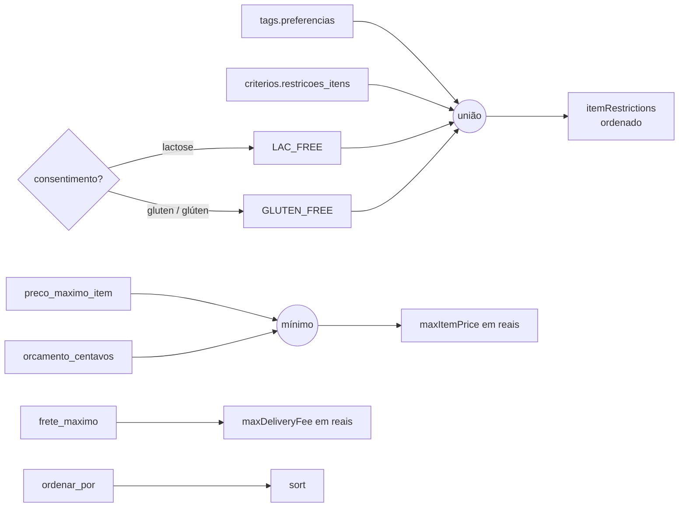
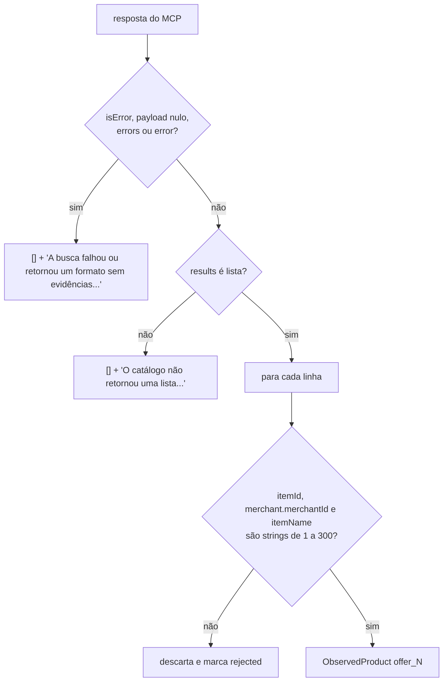

# Regras de negócio

A camada determinística fica em
[`backend/app/recommendations.py`](../../../backend/app/recommendations.py).
Tudo que envolve dinheiro, filtros, evidência comercial e validação da saída do
modelo passa por aqui, em código testado.

## Funções

| Função | Papel |
|---|---|
| `normalized(value)` | Normaliza texto: minúsculas, sem acentos, espaços colapsados |
| `build_refinements(context)` | Monta os filtros do `searchOffers` a partir do contexto |
| `to_cents(value)` | Converte reais em centavos inteiros com segurança |
| `catalogue_payload(payload)` | Extrai o dicionário de resultados do retorno do MCP |
| `observe_products(response, start)` | Transforma resultados do MCP em `ObservedProduct` |
| `calculate_costs(products, context, i)` | Calcula o custo conhecido de uma opção |
| `finalize(draft, context, observed, searches, notes)` | Converte o rascunho do modelo na saída final |

---

## `build_refinements`

Regras:

- `sort` sempre vai (padrão `RELEVANCE`).
- `itemRestrictions` é a união das preferências, dos critérios explícitos e das
  intolerâncias consentidas. Só aparece se não estiver vazio.
- **Só intolerâncias** a lactose e glúten viram filtro, e só com consentimento.
  A comparação usa `normalized`, então "Glúten" vira "gluten".
- **Alergias e condições de saúde nunca viram filtro.** Alergia a leite não vira
  `LAC_FREE`; diabetes não vira `SUGAR_FREE`.
- `maxItemPrice` é o **menor** entre `preco_maximo_item_centavos` e
  `orcamento_centavos`, convertido em reais. Ou seja, o orçamento total também
  limita o preço de cada item, mas isso não garante que a soma caiba.
- Orçamento `0` gera `maxItemPrice: 0`.

Exemplo (do teste `test_filters_are_schema_compatible_and_health_is_not_inferred`):

| Entrada | Saída |
|---|---|
| preferências `VEGETARIAN`; intolerância `Lactose`; alergia `leite`; condição `DIABETES`; consentimento; orçamento 3500; preço máximo 990 | `itemRestrictions: ["LAC_FREE", "VEGETARIAN"]`, `maxItemPrice: 9.9` |

---

## `to_cents`

- Aceita número ou string. Usa `Decimal(str(value))` e arredonda com
  `ROUND_HALF_UP`.
- Devolve `None` para `None`, `bool`, `NaN`, infinito, negativo, maior que
  1.000.000 ou texto inválido.
- Exemplos: `0.1` → `10`; `"4.995"` → `500`.

---

## `catalogue_payload`

Aceita dois formatos de retorno do MCP:

1. Um dicionário (`structured_content`).
2. Uma lista com **exatamente um** bloco `{"type": "text"}` cujo texto é um
   objeto JSON.

Qualquer outro formato devolve `None`.

---

## `observe_products`

Mapeamento de cada linha:

| Campo | Regra |
|---|---|
| `referencia` | `offer_{start + n}`, contínua entre buscas da mesma execução |
| `preco_observado_centavos` | `promotionalUnitPrice` se existir e for ≤ `unitPrice`; senão `unitPrice` |
| `frete_observado_centavos` | `merchant.deliveryMethod.promotionalFee`; senão `fee` |
| `minimo_pedido_centavos` | `merchant.minimumOrderAmount` |
| `loja_observada` | `merchant.merchantName`, se for string |

Retorno: `(produtos, erro)`. Se alguma linha foi descartada, o erro é
"Resultados sem identificação utilizável foram descartados.", mas os produtos
válidos continuam.

Lista vazia sem erro (`results: []`) devolve `([], None)`, que vira
`status=empty`.

---

## `calculate_costs`

Para uma opção:

1. **Subtotal** = Σ `preco_observado_centavos × quantidade_embalagens`. Itens sem
   preço contam como 0, e `precos_completos` fica `false`.
2. **Frete:** agrupa por `merchant_id`. Cada loja conta **uma vez**, e só se
   todos os produtos daquela loja tiverem o mesmo frete observado e não nulo.
   Fretes conflitantes ou ausentes não entram, e `fretes_completos` fica
   `false`.
3. **Total conhecido** = subtotal + fretes conhecidos.
4. **Orçamento:**

| Condição | `orcamento_status` |
|---|---|
| Sem orçamento | `not_applicable` |
| Total conhecido > orçamento | `over` |
| Caso contrário | `unknown_total` |

`total_final` é sempre `false`.

Exemplo (`test_costs_per_option_deduplicate_freight_and_never_claim_final_total`):
dois itens da mesma loja (4,99 × 2 e 2,01), frete 4,50 e orçamento 15,00 →
subtotal 1199, frete 450, total 1649, `over`.

---

## `finalize`

Converte o `AgentDraft` do modelo no `AgentOutput` final.

| Passo | Regra |
|---|---|
| 1. Limitações | Junta as notas das buscas com as do modelo, sem duplicatas |
| 2. `usa` | Mantém só nomes que estão no inventário confirmado (comparação normalizada) |
| 3. Faltantes | Nomes de `usa` que não estão no inventário viram faltantes, com a limitação "Ingredientes ainda não confirmados foram tratados como faltantes." |
| 4. Faltantes já existentes | Removidos (não se compra o que já existe) |
| 5. Estratégia | `USE_WHAT_I_HAVE` com faltantes vira `COMPLETE_WITH_MARKET` |
| 6. Seleções | Descarta se a referência não existe, se o índice da opção é inválido, se o faltante não é da opção ou se é duplicada (opção, loja, item) |
| 7. Produtos | Junta `ObservedProduct` com a seleção, gerando `SelectedProduct` |
| 8. Pergunta de tags | Só vale se o modelo pediu, o estado é `NOT_ASKED` e não há nenhuma tag |
| 9. Mensagem | Todas as buscas com erro → mensagem fixa de falha; todas vazias → mensagem fixa de vazio |
| 10. Texto da pergunta | Se a pergunta vale, acrescenta o texto padrão sobre preferências |
| 11. Avisos | Alergias/intolerâncias, condições de saúde e produtos geram limitações padronizadas |
| 12. Custos | `calculate_costs` para cada opção que tem produtos |
| 13. Contexto reconhecido | Repassa `contexto_reconhecido` do rascunho sem aplicá-lo ao contexto, aos filtros ou aos custos |

Mensagens fixas:

- Falha: "Não foi possível concluir a consulta ao iFood. Tente novamente; nenhum
  produto foi confirmado."
- Vazio: "Nenhum produto foi encontrado para os termos, critérios e localização
  consultados."

## Veja também

- [Saída estruturada do agente](../04-agente/saida-estruturada.md)
- [Contratos de dados](../02-arquitetura/contratos-de-dados.md)
- [Testes](testes.md)
