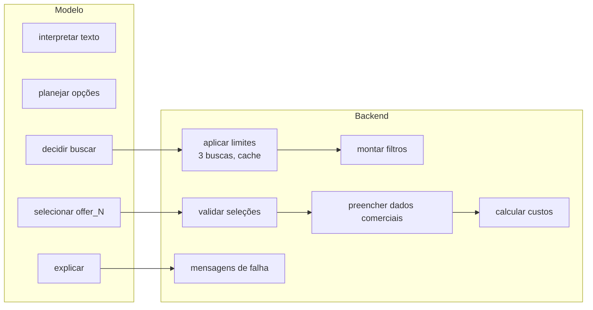

# Agente

O agente da Despensa Reversa interpreta o contexto do consumidor, planeja
refeições e decide quando consultar o iFood Mercado. Código em
[`backend/app/agent.py`](../../../backend/app/agent.py).

## Ficha técnica

| Item | Valor |
|---|---|
| Biblioteca | OpenAI Agents SDK (`openai-agents`) |
| Nome | `Despensa Reversa` |
| Modelo | `OPENAI_MODEL`, padrão `gpt-4.1-mini` |
| Instruções | `AGENT_INSTRUCTIONS` (português) |
| Ferramentas | Uma: `search_market_items` |
| Saída | Estruturada, tipo `AgentDraft` (schema estrito) |
| `max_tokens` | 2200 |
| `parallel_tool_calls` | `False` |
| `store` | `False` (a OpenAI não guarda a conversa) |
| `max_turns` | 6 |
| Tracing | Desligado (`tracing_disabled=True`, `trace_include_sensitive_data=False`) |
| Timeout | 90 s (aplicado pela rota) |
| Estado | Nenhum; tudo vem no envelope |

A captura por foto usa um **segundo agente**, sem ferramentas, descrito em
[Reconhecimento de imagem](reconhecimento-de-imagem.md). Esta seção trata do
agente de planejamento, salvo indicação em contrário.

## O que o agente faz

1. **Organiza** ingredientes citados no texto em `ingredientes_reconhecidos`, e
   objetivo, pessoas, tempo e orçamento em `contexto_reconhecido`, para a pessoa
   confirmar.
2. **Planeja** até três opções de refeição, cada uma com uma estratégia,
   ingredientes usados, faltantes e justificativa.
3. **Pergunta** sobre preferências uma única vez, se ninguém informou nada
   (`pergunta_tags`).
4. **Busca** faltantes no iFood Mercado quando a pessoa escolhe uma opção com
   faltantes ou pede uma busca.
5. **Seleciona** produtos por referência (`offer_N`) e associa cada um a um
   faltante.
6. **Explica** a decisão e informa limitações.

## O que o agente não faz

- Não escreve nomes de produtos, lojas, preços nem totais nos textos.
- Não inventa IDs. Seleções sem evidência são descartadas pelo backend.
- Não infere localização, perfil alimentar nem condições de saúde.
- Não diagnostica, não prescreve e não garante segurança para alergias.
- Não cria carrinho, não aplica voucher e não faz pedido. Não tem ferramentas
  para isso.
- Não guarda memória. Não diz que "salvou" preferências.

## Divisão de responsabilidades

## Páginas desta seção

| Página | Conteúdo |
|---|---|
| [Ciclo de execução](ciclo-de-execucao.md) | Passo a passo de `run_agent` |
| [Instruções e políticas](instrucoes-e-politicas.md) | O prompt de sistema comentado |
| [Ferramenta `search_market_items`](ferramenta-search-market-items.md) | Contrato e comportamento da ferramenta |
| [Saída estruturada](saida-estruturada.md) | `AgentDraft`, `AgentOutput` e a sanitização |
| [Reconhecimento de imagem](reconhecimento-de-imagem.md) | O agente de captura por foto e o tratamento da imagem |

## Evoluções previstas

- Ferramentas de carrinho (`createCart`, `getCart`) com confirmação explícita
  antes de qualquer escrita.
- Medir a precisão do reconhecimento de imagem com fotos reais de despensa.

Ver [Limitações e roadmap](../06-operacao/limitacoes-e-roadmap.md).
