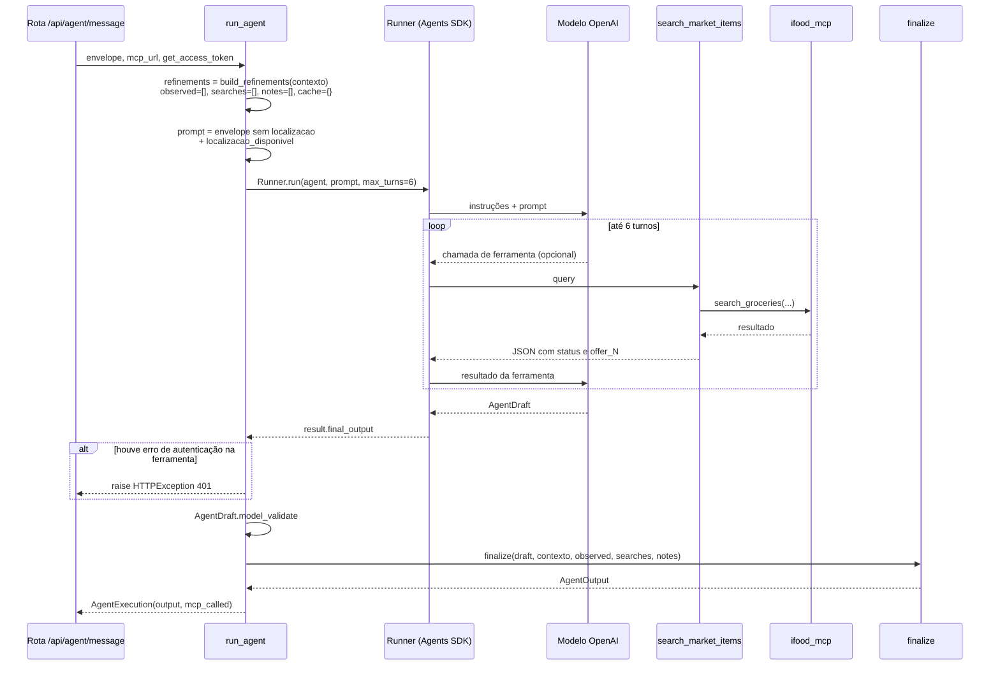

# Ciclo de execução

O que acontece numa chamada a
`run_agent(envelope, *, mcp_url, get_access_token)` em
[`backend/app/agent.py`](../../../backend/app/agent.py).

## Visão geral



## Passo a passo

### 1. Preparação

```python
context = envelope.contexto
refinements = build_refinements(context)
observed: list[ObservedProduct] = []
searches: list[SearchEvidence] = []
notes: list[str] = []
cached: dict[str, str] = {}
auth_error: HTTPException | None = None
mcp_called = False
tool_lock = asyncio.Lock()
```

- Os **filtros são calculados uma vez**, a partir do contexto, antes do modelo
  rodar. O modelo não escolhe filtros.
- `observed`, `searches` e `notes` acumulam evidências entre as buscas.
- `tool_lock` serializa as chamadas da ferramenta, mesmo que o SDK tente
  paralelizar.

### 2. Montagem do prompt

```python
prompt = envelope.model_dump(mode="json", exclude={"contexto": {"localizacao"}})
prompt["localizacao_disponivel"] = context.localizacao is not None
```

O modelo recebe, como **mensagem de usuário**, o envelope em JSON:

```json
{
  "contract_version": "1",
  "mensagem_usuario": "...",
  "contexto": {
    "tags_declaradas": { "...": "..." },
    "inventario_confirmado": [ "..." ],
    "objetivo": "jantar", "pessoas": 2, "tempo_min": 30,
    "orcamento_centavos": 3500,
    "criterios_busca": { "...": "..." },
    "consentimento_dados_sensiveis": false
  },
  "historico_resumido": [],
  "localizacao_disponivel": true
}
```

Não há coordenadas nem tokens no prompt.

### 3. Criação do agente

```python
Agent(
    name="Despensa Reversa",
    model=os.getenv("OPENAI_MODEL", "gpt-4.1-mini"),
    instructions=AGENT_INSTRUCTIONS,
    tools=[search_market_items],
    output_type=AgentDraft,
    model_settings=ModelSettings(max_tokens=2200, parallel_tool_calls=False, store=False),
)
```

O agente é criado **a cada execução**, porque a ferramenta é uma closure sobre o
contexto e os acumuladores daquela execução.

### 4. Execução

```python
Runner.run(agent, json.dumps(prompt, ensure_ascii=False), max_turns=6,
           run_config=RunConfig(tracing_disabled=True, trace_include_sensitive_data=False))
```

- **6 turnos** bastam para até 3 buscas mais a resposta final.
- O SDK valida a saída final contra o schema estrito de `AgentDraft`.

### 5. Erro de autenticação

Se a ferramenta tentou pegar o token e recebeu `HTTPException` (sem login ou
sessão expirada), ela guarda o erro em `auth_error` e responde ao modelo com
`AUTH_REQUIRED`. Depois da execução, `run_agent` **relança** esse erro, e a rota
responde `401`. Assim, a falta de login nunca aparece como "catálogo vazio".

### 6. Finalização

```python
draft = AgentDraft.model_validate(result.final_output)
return AgentExecution(finalize(draft, context, observed, searches, notes), mcp_called)
```

`finalize` aplica todas as regras de sanitização (ver
[Saída estruturada](saida-estruturada.md) e
[Regras de negócio](../03-backend/regras-de-negocio.md#finalize)).

`mcp_called` vira `true` assim que uma busca é de fato enviada ao MCP (depois de
obter o token), mesmo que ela falhe.

## Tratamento de erros na rota

| Exceção em `run_agent` | Resposta |
|---|---|
| `HTTPException` (ex.: `401` de autenticação) | Repassada como está |
| `TimeoutError` (90 s) | `504` "O agente excedeu o tempo de execução. Nenhuma compra foi realizada." |
| Qualquer outra (modelo, saída inválida, rede) | `502` "O agente não produziu uma resposta válida. Tente novamente." |

Em todos os casos de erro, nada é gravado na sessão.

## Os três tipos de chamada do frontend

O mesmo agente atende três momentos, diferenciados só pela mensagem e pelo
contexto:

| Momento | Mensagem | Contexto | Resultado esperado |
|---|---|---|---|
| Captura | "Organize os ingredientes e os detalhes do pedido abaixo para eu conferir. Ainda não planeje refeições nem busque produtos. Pedido: …" | Inventário vazio | `ingredientes_reconhecidos` e `contexto_reconhecido` |
| Planejamento | Texto original da pessoa | Inventário confirmado, perfil, objetivo, sem localização | `opcoes` |
| Mercado | "Escolhi esta opção: {…}. Mantenha essa refeição como única opção e busque no iFood Mercado apenas os ingredientes faltantes dela." | Tudo + localização | `produtos`, `buscas`, `custos` |

A captura **com foto** não passa por `run_agent`: usa o agente de
[Reconhecimento de imagem](reconhecimento-de-imagem.md).

## Veja também

- [Ferramenta `search_market_items`](ferramenta-search-market-items.md)
- [Instruções e políticas](instrucoes-e-politicas.md)
- [Fluxo da aplicação](../02-arquitetura/fluxo-da-aplicacao.md)
