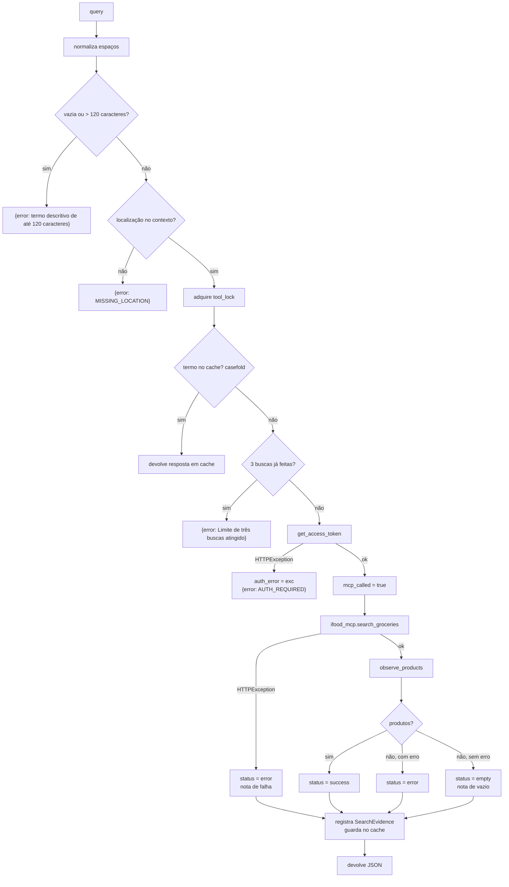

# Ferramenta `search_market_items`

Única ferramenta do agente. É uma função local, decorada com `@function_tool`
dentro de `run_agent`, que encapsula o `searchOffers` do MCP. Código em
[`backend/app/agent.py`](../../../backend/app/agent.py).

## Contrato visto pelo modelo

```text
search_market_items(query: str) -> str

Busca um ingrediente ou produto no iFood Mercado, somente leitura.

Passe conteúdo descritivo, sem preço, frete ou distância. Os filtros
estruturados declarados no contexto são aplicados pela aplicação.
```

O modelo passa **só o termo**. Localização, filtros, vertical, tipo de resultado
e tamanho da página são definidos pelo backend.

## Fluxo interno



## Respostas possíveis

### Sucesso, vazio ou falha

```json
{
  "status": "success",
  "produtos": [
    {
      "referencia": "offer_1",
      "item_id": "...",
      "merchant_id": "...",
      "nome_observado": "...",
      "loja_observada": "...",
      "preco_observado_centavos": 499,
      "frete_observado_centavos": 450,
      "minimo_pedido_centavos": null,
      "provenance": "MCP"
    }
  ],
  "refinements_aplicados": { "sort": "RELEVANCE", "itemRestrictions": ["VEGAN"] },
  "aviso": "Observações MCP; ausência de alérgenos e total final não verificados."
}
```

`status` pode ser `success`, `empty` ou `error`. Nos dois últimos, `produtos`
vem vazio.

### Erros de guarda (não contam como busca)

| Retorno | Quando | Chama o MCP? | Registra busca? |
|---|---|---|---|
| `{"error":"A busca exige um termo descritivo de até 120 caracteres."}` | Termo vazio ou longo | Não | Não |
| `{"error":"MISSING_LOCATION: ..."}` | Sem `contexto.localizacao` | Não | Não |
| `{"error":"Limite de três buscas atingido; ..."}` | 4ª busca distinta | Não | Não |
| `{"error":"AUTH_REQUIRED: ..."}` | Sem login ou sessão expirada | Não | Não; a rota responde `401` no fim |

## Limites e cache

- **3 buscas distintas** por execução (`MAX_MARKET_SEARCHES_PER_RUN`).
- **Cache por termo**, sem diferenciar maiúsculas de minúsculas (`casefold`):
  "cebola" e "CEBOLA" fazem uma única chamada.
- O cache e o limite valem **mesmo com chamadas concorrentes**, graças ao
  `tool_lock` (`test_parallel_invocations_respect_three_searches_and_cache`).
- Cada busca pede **5 resultados** (`pageSize`).

## Referências `offer_N`

Os produtos recebem referências sequenciais e contínuas entre as buscas da mesma
execução (`offer_1`, `offer_2`, …), calculadas com `start=len(observed)`. O
modelo usa essas referências em `selecoes`. O backend as resolve no registro
`observed` em `finalize`.

O modelo **vê** nomes e preços no retorno da ferramenta (precisa deles para
escolher), mas é instruído a não reproduzi-los nos textos. Os cards da interface
usam só os dados do registro.

## Notas de limitação geradas

| Situação | Nota adicionada |
|---|---|
| Resultado com erro ou formato inválido | "A busca falhou ou retornou um formato sem evidências de produtos utilizáveis." |
| Linhas sem identificação descartadas | "Resultados sem identificação utilizável foram descartados." |
| Busca vazia | "Nenhum produto utilizável encontrado para {query}." |
| `HTTPException` na chamada | "A consulta ao MCP falhou; não há dados comerciais confirmados para essa busca." |

## Veja também

- [Integração MCP](../03-backend/integracao-mcp.md)
- [Regras de negócio · `observe_products`](../03-backend/regras-de-negocio.md#observe_products)
- [Ciclo de execução](ciclo-de-execucao.md)
