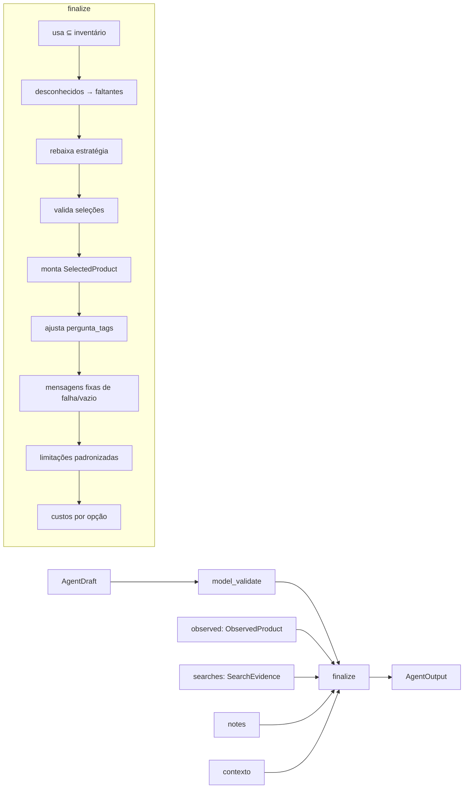

# Saída estruturada

O modelo não devolve texto livre. Ele preenche um objeto `AgentDraft`, validado
por schema estrito, que o backend transforma em `AgentOutput`.

## Por que dois modelos

| | `AgentDraft` (modelo) | `AgentOutput` (backend) |
|---|---|---|
| Quem preenche | O LLM | `finalize` |
| Dados comerciais | Só referências `offer_N` | Nomes, IDs, preços, frete e mínimo copiados do MCP |
| Custos | Não tem | `custos` calculados |
| Buscas | Não tem | `buscas` registradas pela ferramenta |
| Confiança | Interpretado | Validado e sanitizado |

A ideia central: **o modelo não tem onde escrever um preço**. O schema não
oferece esse campo.

## `AgentDraft`

```python
class AgentDraft(Contract):
    """O modelo escolhe referências; não fornece nomes, IDs, preços ou totais."""
    mensagem: str                                   # até 3000 caracteres
    pergunta_tags: bool = False
    contexto_reconhecido: RecognizedContext         # objetivo, pessoas, tempo, orçamento
    ingredientes_reconhecidos: list[RecognizedIngredient]   # até 80
    opcoes: list[MealOption]                        # até 3
    selecoes: list[ProductSelection]                # até 15
    limitacoes: list[str]                           # até 20
```

### `ProductSelection`

| Campo | Regra |
|---|---|
| `referencia` | Até 40 caracteres (ex.: `offer_2`) |
| `faltante` | Nome de um faltante da opção |
| `opcao_indice` | 0 a 2 |
| `quantidade_embalagens` | 1 a 100, padrão 1 |

### Schema estrito

O Agents SDK gera um JSON Schema com `additionalProperties: false` e todos os
campos obrigatórios (`test_sdk_strict_output_schema`). Com saída estruturada, o
modelo não consegue acrescentar campos.

## Do rascunho à saída



Detalhes de cada passo em
[Regras de negócio · `finalize`](../03-backend/regras-de-negocio.md#finalize).

## Exemplos de sanitização

### Ingrediente não confirmado

Inventário confirmado: `arroz`. O modelo propõe:

```json
{ "titulo": "Preparo", "estrategia": "USE_WHAT_I_HAVE", "usa": ["arroz", "ovos"], "faltantes": ["arroz"] }
```

Depois de `finalize`:

```json
{ "titulo": "Preparo", "estrategia": "COMPLETE_WITH_MARKET", "usa": ["arroz"], "faltantes": ["ovos"] }
```

E a limitação "Ingredientes ainda não confirmados foram tratados como
faltantes." é acrescentada.

### Referência inventada

O modelo seleciona `offer_1`, `inventada` e `offer_1` de novo. Só a primeira
`offer_1` sobrevive, e é acrescentada a limitação "Seleção sem evidência ou sem
vínculo com um faltante foi descartada.".

### Falha mascarada

Todas as buscas têm `status=error`, e o modelo escreve "Não há produtos no
catálogo.". A mensagem é substituída por "Não foi possível concluir a consulta
ao iFood. Tente novamente; nenhum produto foi confirmado.".

## Campos de procedência fixos

Alguns campos são `Literal` e não podem ser alterados pelo modelo:

| Modelo | Campo | Valor fixo |
|---|---|---|
| `RecognizedIngredient` | `provenance` / `confirmado` | `"INFERRED"` / `false` |
| `RecognizedContext` | `provenance` / `confirmado` | `"INFERRED"` / `false` |
| `MealOption` | `provenance` | `"INFERRED"` |
| `ObservedProduct` | `provenance` | `"MCP"` |
| `SelectedProduct` | `quantidade_provenance` / `quantidade_confirmada` | `"INFERRED"` / `false` |
| `CostSummary` | `provenance` / `total_final` | `"ESTIMATED"` / `false` |

## Veja também

- [Contratos de dados](../02-arquitetura/contratos-de-dados.md)
- [Instruções e políticas](instrucoes-e-politicas.md)
