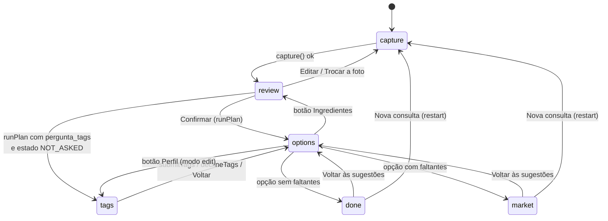

# Fluxo de telas

O `App.tsx` controla uma máquina de estados simples, com a variável `stage`.

## Etapas

```ts
type Stage = 'capture' | 'review' | 'tags' | 'options' | 'market' | 'done'
```

A barra de progresso mostra três passos e mapeia as etapas assim:

| Passo visível | Etapas |
|---|---|
| 1. Sua despensa | `capture`, `review`, `tags` |
| 2. Sugestões do agente | `options` |
| 3. Só o que falta | `market`, `done` |

## Máquina de estados



A função `go(stage)` limpa o erro atual e troca de etapa. Depois de cada troca, a
página rola ao topo e o foco vai para o título da etapa (`#stage-title`).

## Etapa a etapa

### `capture` — Sua despensa

- Campo de texto (até 4000 caracteres), botão "Experimentar com um exemplo" e
  `PhotoInput` (câmera e upload).
- **Ação:** `capture()`.
  - **Sem foto:** envia ao agente:
    ```text
    Organize os ingredientes e os detalhes do pedido abaixo para eu conferir.
    Ainda não planeje refeições nem busque produtos. Pedido: {texto}
    ```
    com contexto de inventário vazio (mais tags e consentimento atuais).
  - **Com foto:** `api.parseImage(dataUrl, texto)` →
    `POST /api/context/parse-image`, que reconhece os ingredientes da foto e
    devolve o mesmo formato (ver
    [Reconhecimento de imagem](../04-agente/reconhecimento-de-imagem.md)). Com
    foto anexada, essa é a única chamada; o texto vai junto.
- **No sucesso:**
  - `items` ← `ingredientes_reconhecidos` (sem duplicatas, origem `INFERRED`).
  - `fields` ← `contexto_reconhecido` (objetivo, pessoas, tempo e orçamento
    citados no texto; vazios se não foram mencionados).
  - `plan` é zerado (opções geradas com inventário vazio são descartadas).
  - Se `pergunta_tags`, as tags passam a `ASKED`.
  - Vai para `review`.

### `review` — revisão

- Lista de ingredientes editáveis. Editar um item muda sua origem para
  `DECLARED`.
- Adicionar ingrediente (sem duplicatas normalizadas, até 80).
- Seção "Seu pedido": objetivo, pessoas, tempo e orçamento, com validação.
- Seção "Preferências e restrições" (`PreferenceFields`).
- O botão "Confirmar e receber sugestões" fica desabilitado sem ingredientes ou
  com erro de validação.
- **Ação:** `confirmReview()` marca as tags como `ANSWERED` e chama `runPlan`.

### Planejamento (`runPlan`)

Envia ao agente o texto original (ou "Sugira refeições com os ingredientes que
confirmei na revisão da foto.") com o contexto completo, **sem localização**.

- Se `pergunta_tags` vier `true` e o estado for `NOT_ASKED`, vai para `tags` no
  modo pergunta.
- Senão, vai para `options`.

Como `confirmReview` já marca `ANSWERED`, o modo pergunta raramente aparece no
caminho principal.

### `tags` — preferências

Dois modos:

| Modo | Origem | Botões |
|---|---|---|
| `question` | O agente perguntou | "Continuar com essas informações" (exige ao menos uma informação), "Prefiro não informar" |
| `edit` | Botão "Perfil" em `options` | "Aplicar e atualizar sugestões", "Voltar sem alterar" |

- `submitTags`: grava as tags e o consentimento e chama `runPlan`.
- `declineTags`: zera as tags com estado `DECLINED`. Se já há opções, volta a
  `options`; senão, chama `runPlan`.

### `options` — sugestões

- Mostra o perfil atual, com atalhos para editar ingredientes e perfil.
- Cards das opções: estratégia, título, justificativa, "Você já tem" e
  "Falta"/"Para comprar".
- Mensagem do agente numa seção expansível, mais as limitações.
- Em erro, botão "Tentar novamente".
- **Ação:** `choose(opção)`:
  - Sem faltantes → `done`.
  - Com faltantes → `market` e reconsulta `/auth/status`.

### `market` — só o que falta

1. **Conta iFood:** se não conectada, "Conectar conta iFood" abre `/auth/login`
   numa nova aba. Ao voltar para a aba (eventos `focus` e `visibilitychange`), o
   app reconsulta `/auth/status`.
2. **Onde buscar:** GPS (`navigator.geolocation`, timeout 10 s) ou coordenadas
   manuais validadas.
3. **Busca automática:** quando `auth === 'yes'`, há localização e opção
   escolhida, ainda não há resultado e não houve tentativa, o app chama
   `consultMarket()` **uma vez** (`autoSearchAttempted`). Trocar a localização
   libera uma nova tentativa automática.

Mensagem enviada:

```text
Escolhi esta opção: {JSON da opção}. Mantenha essa refeição como única opção e
busque no iFood Mercado apenas os ingredientes faltantes dela.
```

O resultado mostra produtos por faltante, custo conhecido, registro de
consultas, limitações e o aviso de que não há carrinho. Com a conta conectada,
uma seção técnica lista as ferramentas do `tools/list`.

### `done` — sem compra

Mostra a opção escolhida e "Nenhuma compra necessária", com lembrete de conferir
validade e conservação.

### `restart`

Limpa texto, foto, mensagem, itens, campos, plano, escolha e resultado, e volta a
`capture`. **Mantém** tags, consentimento e localização.

## Indicadores globais

- **Pílula de conexão** no cabeçalho: "Backend fora do ar", "iFood conectado",
  "Conecte ao buscar no Mercado", "Status indisponível" ou "Verificando…".
- **Alerta de backend fora do ar**, com botão "Tentar reconectar".
- **Barra lateral** com os ingredientes e os fatos do pedido depois da captura.
- **Rodapé** "Como funciona e de onde vêm os dados?" com a legenda de
  procedência.

## Veja também

- [Estado e integração](estado-e-integracao.md)
- [Fluxo da aplicação](../02-arquitetura/fluxo-da-aplicacao.md)
