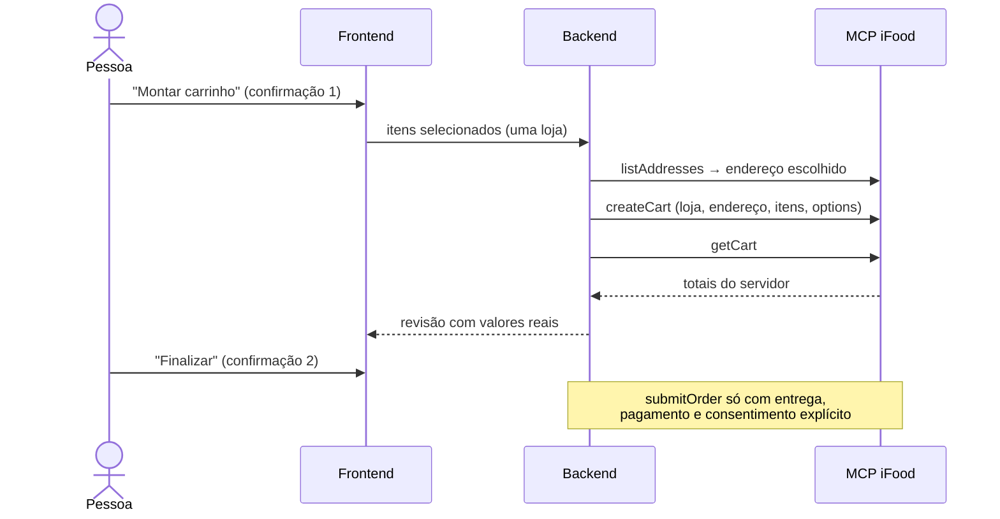

# Limitações e roadmap

## Limitações atuais

| Limitação | Impacto | Onde está a decisão |
|---|---|---|
| **Sem carrinho nem pedido** | O fluxo termina na lista de produtos observados | `agent.py` (instruções), `MarketStep.tsx` |
| Precisão da foto não medida | Validada só com imagens de teste; câmera física não testada num aparelho | `vision.py` |
| HEIC não aceito | Fotos de iPhone precisam ser convertidas para JPEG | `PhotoInput.tsx`, `vision.py` |
| Um usuário por processo | Tokens OAuth globais | `oauth.py`, `main.py` |
| Execuções serializadas | Lock global durante toda a execução do agente | `main.py` (`store.lock`) |
| Estado só em memória | Reiniciar perde login e sessões | `lifespan` em `main.py` |
| Preço não revalidado | Preço observado na busca, sem `getItem`/`getMerchant` | Ferramentas não anunciadas no escopo atual |
| Total final desconhecido | Embalagem, taxas e mínimo precisam de revisão | `calculate_costs` |
| Orçamento como teto por item | `maxItemPrice` usa o orçamento total | `build_refinements` |
| Até 3 buscas por execução | Opções com muitos faltantes ficam parcialmente consultadas | `MAX_MARKET_SEARCHES_PER_RUN` |
| Filtros não comprovam composição | Sem garantia para alergias ou adequação clínica | `build_refinements`, `finalize` |
| Sem testes no frontend | Só a checagem de tipos do build | `frontend/` |
| Credenciais iFood ausentes → `500` em `/mcp/tools` | Erro pouco claro | `oauth.access_token` → `validate_oauth` |

## Roadmap

### Prioridade alta (aderência ao desafio)

#### 1. Carrinho pelo MCP

Fluxo proposto, todo com confirmação explícita:

Requisitos:

- Escopos de carrinho no `IFOOD_SCOPES` e no portal.
- Novas ferramentas no agente ou endpoints dedicados, sempre com confirmação
  pela interface (o agente não escreve sozinho).
- Uma loja por carrinho; nunca repetir automaticamente uma escrita com resultado
  incerto.
- Mudança de preço ou de carrinho invalida a aprovação anterior.
- Pontos a validar com o iFood antes: `cardTokenId` e `selectedTimeSlotId` (ver
  [Feedback sobre os MCPs](../../entregaveis/06-feedback-mcp.md)).

#### 2. Validar a foto com uso real

- Testar a câmera física no aparelho da demonstração.
- Medir a precisão com fotos reais de despensa e geladeira.

### Entregue

| Item | Onde |
|---|---|
| Reconhecimento de foto (`POST /api/context/parse-image`) | [Reconhecimento de imagem](../04-agente/reconhecimento-de-imagem.md) |
| `contexto_reconhecido` (objetivo, pessoas, tempo e orçamento para revisão) | [Contratos de dados](../02-arquitetura/contratos-de-dados.md#recognizedcontext) |

### Prioridade média (produto)

- Revalidar preço e disponibilidade com `getItem`/`getMerchant`, quando o escopo
  permitir.
- Persistência de perfil com consentimento por finalidade.
- Comparação lado a lado entre alternativas.
- Sessão por cookie e isolamento multiusuário.
- Mensagens de erro claras para credenciais iFood ausentes.

### Prioridade baixa (expansão)

- Petshop (`PETSTORE`) com perfil do animal.
- Farmácia (`DRUGSTORE`) para higiene e cuidados pessoais, sem medicamentos.
- Entrada por voz.
- Perfis familiares e reposição automática.
- Integração com dispositivos (ex.: óculos inteligentes), aproveitando o núcleo
  independente de interface.

### Qualidade

- Testes do frontend (fluxo de etapas e mapeamento de erros).
- Geração automática de `types.ts` a partir dos JSON Schemas.
- Observabilidade: métricas de duração do agente, buscas por execução e taxa de
  `error`/`empty`, sem dados sensíveis.

## Veja também

- [Estado atual](../01-visao-geral/estado-atual.md)
- [Decisões arquiteturais](../02-arquitetura/decisoes-arquiteturais.md)
- [Manutenção da wiki · Atualizações pendentes](../MANUTENCAO.md#atualizações-pendentes):
  o que mudar na documentação quando cada item do roadmap for entregue
