# Índice da wiki

> **Arquivo gerado.** Não edite à mão: rode
> `python docs/wiki/_scripts/gerar_indice.py` depois de criar, mover ou
> renomear páginas ou de mudar links. Ver [Manutenção da wiki](MANUTENCAO.md).

**32 páginas · 158 links entre páginas · 25 arquivos do repositório citados**

Para começar a ler, use a [Home](README.md).

## Páginas por seção

### Entrada e manutenção

| Página | Arquivo | Links para | Citada por |
|---|---|---|---|
| [Wiki — CompletAI](README.md) | `README.md` | 31 | 1 |
| [Manutenção da wiki](MANUTENCAO.md) | `MANUTENCAO.md` | 31 | 2 |

### 1. Visão geral

| Página | Arquivo | Links para | Citada por |
|---|---|---|---|
| [Estado atual](01-visao-geral/estado-atual.md) | `01-visao-geral/estado-atual.md` | 2 | 4 |
| [Glossário](01-visao-geral/glossario.md) | `01-visao-geral/glossario.md` | 2 | 2 |
| [Produto](01-visao-geral/produto.md) | `01-visao-geral/produto.md` | 2 | 3 |

### 2. Arquitetura

| Página | Arquivo | Links para | Citada por |
|---|---|---|---|
| [Contratos de dados](02-arquitetura/contratos-de-dados.md) | `02-arquitetura/contratos-de-dados.md` | 2 | 8 |
| [Decisões arquiteturais](02-arquitetura/decisoes-arquiteturais.md) | `02-arquitetura/decisoes-arquiteturais.md` | 3 | 4 |
| [Fluxo da aplicação](02-arquitetura/fluxo-da-aplicacao.md) | `02-arquitetura/fluxo-da-aplicacao.md` | 4 | 6 |
| [Segurança e privacidade](02-arquitetura/seguranca-e-privacidade.md) | `02-arquitetura/seguranca-e-privacidade.md` | 3 | 7 |
| [Visão geral da arquitetura](02-arquitetura/visao-geral.md) | `02-arquitetura/visao-geral.md` | 3 | 3 |

### 3. Backend

| Página | Arquivo | Links para | Citada por |
|---|---|---|---|
| [Backend](03-backend/README.md) | `03-backend/README.md` | 11 | 3 |
| [Referência da API](03-backend/api-referencia.md) | `03-backend/api-referencia.md` | 4 | 6 |
| [Autenticação OAuth](03-backend/autenticacao-oauth.md) | `03-backend/autenticacao-oauth.md` | 2 | 6 |
| [Configuração](03-backend/configuracao.md) | `03-backend/configuracao.md` | 2 | 4 |
| [Contexto e sessões](03-backend/contexto-e-sessoes.md) | `03-backend/contexto-e-sessoes.md` | 2 | 4 |
| [Integração MCP](03-backend/integracao-mcp.md) | `03-backend/integracao-mcp.md` | 2 | 5 |
| [Regras de negócio](03-backend/regras-de-negocio.md) | `03-backend/regras-de-negocio.md` | 3 | 9 |
| [Testes](03-backend/testes.md) | `03-backend/testes.md` | 2 | 4 |

### 4. Agente

| Página | Arquivo | Links para | Citada por |
|---|---|---|---|
| [Agente](04-agente/README.md) | `04-agente/README.md` | 6 | 3 |
| [Ciclo de execução](04-agente/ciclo-de-execucao.md) | `04-agente/ciclo-de-execucao.md` | 6 | 7 |
| [Ferramenta `search_market_items`](04-agente/ferramenta-search-market-items.md) | `04-agente/ferramenta-search-market-items.md` | 3 | 6 |
| [Instruções e políticas](04-agente/instrucoes-e-politicas.md) | `04-agente/instrucoes-e-politicas.md` | 3 | 6 |
| [Reconhecimento de imagem](04-agente/reconhecimento-de-imagem.md) | `04-agente/reconhecimento-de-imagem.md` | 3 | 13 |
| [Saída estruturada](04-agente/saida-estruturada.md) | `04-agente/saida-estruturada.md` | 3 | 7 |

### 5. Frontend

| Página | Arquivo | Links para | Citada por |
|---|---|---|---|
| [Frontend](05-frontend/README.md) | `05-frontend/README.md` | 4 | 2 |
| [Componentes](05-frontend/componentes.md) | `05-frontend/componentes.md` | 3 | 5 |
| [Design e acessibilidade](05-frontend/design-e-acessibilidade.md) | `05-frontend/design-e-acessibilidade.md` | 1 | 4 |
| [Estado e integração com a API](05-frontend/estado-e-integracao.md) | `05-frontend/estado-e-integracao.md` | 3 | 5 |
| [Fluxo de telas](05-frontend/fluxo-de-telas.md) | `05-frontend/fluxo-de-telas.md` | 3 | 6 |

### 6. Operação

| Página | Arquivo | Links para | Citada por |
|---|---|---|---|
| [Como rodar](06-operacao/como-rodar.md) | `06-operacao/como-rodar.md` | 2 | 5 |
| [Limitações e roadmap](06-operacao/limitacoes-e-roadmap.md) | `06-operacao/limitacoes-e-roadmap.md` | 5 | 4 |
| [Solução de problemas](06-operacao/solucao-de-problemas.md) | `06-operacao/solucao-de-problemas.md` | 2 | 4 |

## Mapa de links

Cada seta é um link de uma página para outra. Os links que saem da Home
foram omitidos, porque ela aponta para todas as páginas.

```mermaid
flowchart LR
    subgraph s__["Entrada e manutenção"]
      p_README["Wiki — CompletAI"]
      p_MANUTENCAO["Manutenção da wiki"]
    end
    subgraph s_01_visao_geral["1. Visão geral"]
      p_01_visao_geral_estado_atual["Estado atual"]
      p_01_visao_geral_glossario["Glossário"]
      p_01_visao_geral_produto["Produto"]
    end
    subgraph s_02_arquitetura["2. Arquitetura"]
      p_02_arquitetura_contratos_de_dados["Contratos de dados"]
      p_02_arquitetura_decisoes_arquiteturais["Decisões arquiteturais"]
      p_02_arquitetura_fluxo_da_aplicacao["Fluxo da aplicação"]
      p_02_arquitetura_seguranca_e_privacidade["Segurança e privacidade"]
      p_02_arquitetura_visao_geral["Visão geral da arquitetura"]
    end
    subgraph s_03_backend["3. Backend"]
      p_03_backend_README["Backend"]
      p_03_backend_api_referencia["Referência da API"]
      p_03_backend_autenticacao_oauth["Autenticação OAuth"]
      p_03_backend_configuracao["Configuração"]
      p_03_backend_contexto_e_sessoes["Contexto e sessões"]
      p_03_backend_integracao_mcp["Integração MCP"]
      p_03_backend_regras_de_negocio["Regras de negócio"]
      p_03_backend_testes["Testes"]
    end
    subgraph s_04_agente["4. Agente"]
      p_04_agente_README["Agente"]
      p_04_agente_ciclo_de_execucao["Ciclo de execução"]
      p_04_agente_ferramenta_search_market_items["Ferramenta search_market_items"]
      p_04_agente_instrucoes_e_politicas["Instruções e políticas"]
      p_04_agente_reconhecimento_de_imagem["Reconhecimento de imagem"]
      p_04_agente_saida_estruturada["Saída estruturada"]
    end
    subgraph s_05_frontend["5. Frontend"]
      p_05_frontend_README["Frontend"]
      p_05_frontend_componentes["Componentes"]
      p_05_frontend_design_e_acessibilidade["Design e acessibilidade"]
      p_05_frontend_estado_e_integracao["Estado e integração com a API"]
      p_05_frontend_fluxo_de_telas["Fluxo de telas"]
    end
    subgraph s_06_operacao["6. Operação"]
      p_06_operacao_como_rodar["Como rodar"]
      p_06_operacao_limitacoes_e_roadmap["Limitações e roadmap"]
      p_06_operacao_solucao_de_problemas["Solução de problemas"]
    end
    p_MANUTENCAO --> p_03_backend_api_referencia
    p_MANUTENCAO --> p_03_backend_README
    p_MANUTENCAO --> p_06_operacao_solucao_de_problemas
    p_MANUTENCAO --> p_02_arquitetura_fluxo_da_aplicacao
    p_MANUTENCAO --> p_02_arquitetura_contratos_de_dados
    p_MANUTENCAO --> p_04_agente_saida_estruturada
    p_MANUTENCAO --> p_05_frontend_estado_e_integracao
    p_MANUTENCAO --> p_04_agente_instrucoes_e_politicas
    p_MANUTENCAO --> p_04_agente_ferramenta_search_market_items
    p_MANUTENCAO --> p_04_agente_ciclo_de_execucao
    p_MANUTENCAO --> p_04_agente_README
    p_MANUTENCAO --> p_03_backend_configuracao
    p_MANUTENCAO --> p_03_backend_regras_de_negocio
    p_MANUTENCAO --> p_03_backend_integracao_mcp
    p_MANUTENCAO --> p_03_backend_autenticacao_oauth
    p_MANUTENCAO --> p_02_arquitetura_seguranca_e_privacidade
    p_MANUTENCAO --> p_03_backend_contexto_e_sessoes
    p_MANUTENCAO --> p_04_agente_reconhecimento_de_imagem
    p_MANUTENCAO --> p_06_operacao_como_rodar
    p_MANUTENCAO --> p_02_arquitetura_visao_geral
    p_MANUTENCAO --> p_03_backend_testes
    p_MANUTENCAO --> p_05_frontend_fluxo_de_telas
    p_MANUTENCAO --> p_05_frontend_componentes
    p_MANUTENCAO --> p_05_frontend_design_e_acessibilidade
    p_MANUTENCAO --> p_05_frontend_README
    p_MANUTENCAO --> p_01_visao_geral_estado_atual
    p_MANUTENCAO --> p_06_operacao_limitacoes_e_roadmap
    p_MANUTENCAO --> p_01_visao_geral_produto
    p_MANUTENCAO --> p_02_arquitetura_decisoes_arquiteturais
    p_MANUTENCAO --> p_01_visao_geral_glossario
    p_MANUTENCAO --> p_README
    p_01_visao_geral_estado_atual --> p_04_agente_reconhecimento_de_imagem
    p_01_visao_geral_estado_atual --> p_06_operacao_limitacoes_e_roadmap
    p_01_visao_geral_glossario --> p_04_agente_reconhecimento_de_imagem
    p_01_visao_geral_glossario --> p_01_visao_geral_produto
    p_01_visao_geral_produto --> p_01_visao_geral_estado_atual
    p_01_visao_geral_produto --> p_02_arquitetura_fluxo_da_aplicacao
    p_02_arquitetura_contratos_de_dados --> p_04_agente_saida_estruturada
    p_02_arquitetura_contratos_de_dados --> p_03_backend_regras_de_negocio
    p_02_arquitetura_decisoes_arquiteturais --> p_04_agente_reconhecimento_de_imagem
    p_02_arquitetura_decisoes_arquiteturais --> p_02_arquitetura_visao_geral
    p_02_arquitetura_decisoes_arquiteturais --> p_02_arquitetura_seguranca_e_privacidade
    p_02_arquitetura_fluxo_da_aplicacao --> p_04_agente_reconhecimento_de_imagem
    p_02_arquitetura_fluxo_da_aplicacao --> p_05_frontend_fluxo_de_telas
    p_02_arquitetura_fluxo_da_aplicacao --> p_04_agente_ciclo_de_execucao
    p_02_arquitetura_fluxo_da_aplicacao --> p_03_backend_autenticacao_oauth
    p_02_arquitetura_seguranca_e_privacidade --> p_03_backend_autenticacao_oauth
    p_02_arquitetura_seguranca_e_privacidade --> p_03_backend_contexto_e_sessoes
    p_02_arquitetura_seguranca_e_privacidade --> p_04_agente_instrucoes_e_politicas
    p_02_arquitetura_visao_geral --> p_02_arquitetura_fluxo_da_aplicacao
    p_02_arquitetura_visao_geral --> p_02_arquitetura_decisoes_arquiteturais
    p_02_arquitetura_visao_geral --> p_03_backend_README
    p_03_backend_README --> p_03_backend_api_referencia
    p_03_backend_README --> p_03_backend_configuracao
    p_03_backend_README --> p_02_arquitetura_contratos_de_dados
    p_03_backend_README --> p_03_backend_contexto_e_sessoes
    p_03_backend_README --> p_04_agente_README
    p_03_backend_README --> p_03_backend_regras_de_negocio
    p_03_backend_README --> p_04_agente_reconhecimento_de_imagem
    p_03_backend_README --> p_03_backend_integracao_mcp
    p_03_backend_README --> p_03_backend_autenticacao_oauth
    p_03_backend_README --> p_06_operacao_como_rodar
    p_03_backend_README --> p_03_backend_testes
    p_03_backend_api_referencia --> p_02_arquitetura_contratos_de_dados
    p_03_backend_api_referencia --> p_04_agente_reconhecimento_de_imagem
    p_03_backend_api_referencia --> p_05_frontend_estado_e_integracao
    p_03_backend_api_referencia --> p_06_operacao_solucao_de_problemas
    p_03_backend_autenticacao_oauth --> p_03_backend_integracao_mcp
    p_03_backend_autenticacao_oauth --> p_02_arquitetura_seguranca_e_privacidade
    p_03_backend_configuracao --> p_06_operacao_como_rodar
    p_03_backend_configuracao --> p_03_backend_autenticacao_oauth
    p_03_backend_contexto_e_sessoes --> p_04_agente_ciclo_de_execucao
    p_03_backend_contexto_e_sessoes --> p_02_arquitetura_seguranca_e_privacidade
    p_03_backend_integracao_mcp --> p_03_backend_regras_de_negocio
    p_03_backend_integracao_mcp --> p_04_agente_ferramenta_search_market_items
    p_03_backend_regras_de_negocio --> p_04_agente_saida_estruturada
    p_03_backend_regras_de_negocio --> p_02_arquitetura_contratos_de_dados
    p_03_backend_regras_de_negocio --> p_03_backend_testes
    p_03_backend_testes --> p_03_backend_regras_de_negocio
    p_03_backend_testes --> p_04_agente_ciclo_de_execucao
    p_04_agente_README --> p_04_agente_reconhecimento_de_imagem
    p_04_agente_README --> p_04_agente_ciclo_de_execucao
    p_04_agente_README --> p_04_agente_instrucoes_e_politicas
    p_04_agente_README --> p_04_agente_ferramenta_search_market_items
    p_04_agente_README --> p_04_agente_saida_estruturada
    p_04_agente_README --> p_06_operacao_limitacoes_e_roadmap
    p_04_agente_ciclo_de_execucao --> p_04_agente_saida_estruturada
    p_04_agente_ciclo_de_execucao --> p_03_backend_regras_de_negocio
    p_04_agente_ciclo_de_execucao --> p_04_agente_reconhecimento_de_imagem
    p_04_agente_ciclo_de_execucao --> p_04_agente_ferramenta_search_market_items
    p_04_agente_ciclo_de_execucao --> p_04_agente_instrucoes_e_politicas
    p_04_agente_ciclo_de_execucao --> p_02_arquitetura_fluxo_da_aplicacao
    p_04_agente_ferramenta_search_market_items --> p_03_backend_integracao_mcp
    p_04_agente_ferramenta_search_market_items --> p_03_backend_regras_de_negocio
    p_04_agente_ferramenta_search_market_items --> p_04_agente_ciclo_de_execucao
    p_04_agente_instrucoes_e_politicas --> p_04_agente_ferramenta_search_market_items
    p_04_agente_instrucoes_e_politicas --> p_04_agente_saida_estruturada
    p_04_agente_instrucoes_e_politicas --> p_02_arquitetura_seguranca_e_privacidade
    p_04_agente_reconhecimento_de_imagem --> p_03_backend_api_referencia
    p_04_agente_reconhecimento_de_imagem --> p_05_frontend_componentes
    p_04_agente_reconhecimento_de_imagem --> p_02_arquitetura_seguranca_e_privacidade
    p_04_agente_saida_estruturada --> p_03_backend_regras_de_negocio
    p_04_agente_saida_estruturada --> p_02_arquitetura_contratos_de_dados
    p_04_agente_saida_estruturada --> p_04_agente_instrucoes_e_politicas
    p_05_frontend_README --> p_05_frontend_fluxo_de_telas
    p_05_frontend_README --> p_05_frontend_estado_e_integracao
    p_05_frontend_README --> p_05_frontend_componentes
    p_05_frontend_README --> p_05_frontend_design_e_acessibilidade
    p_05_frontend_componentes --> p_04_agente_reconhecimento_de_imagem
    p_05_frontend_componentes --> p_05_frontend_design_e_acessibilidade
    p_05_frontend_componentes --> p_05_frontend_fluxo_de_telas
    p_05_frontend_design_e_acessibilidade --> p_05_frontend_componentes
    p_05_frontend_estado_e_integracao --> p_02_arquitetura_contratos_de_dados
    p_05_frontend_estado_e_integracao --> p_03_backend_api_referencia
    p_05_frontend_estado_e_integracao --> p_05_frontend_fluxo_de_telas
    p_05_frontend_fluxo_de_telas --> p_04_agente_reconhecimento_de_imagem
    p_05_frontend_fluxo_de_telas --> p_05_frontend_estado_e_integracao
    p_05_frontend_fluxo_de_telas --> p_02_arquitetura_fluxo_da_aplicacao
    p_06_operacao_como_rodar --> p_03_backend_configuracao
    p_06_operacao_como_rodar --> p_06_operacao_solucao_de_problemas
    p_06_operacao_limitacoes_e_roadmap --> p_04_agente_reconhecimento_de_imagem
    p_06_operacao_limitacoes_e_roadmap --> p_02_arquitetura_contratos_de_dados
    p_06_operacao_limitacoes_e_roadmap --> p_01_visao_geral_estado_atual
    p_06_operacao_limitacoes_e_roadmap --> p_02_arquitetura_decisoes_arquiteturais
    p_06_operacao_limitacoes_e_roadmap --> p_MANUTENCAO
    p_06_operacao_solucao_de_problemas --> p_03_backend_api_referencia
    p_06_operacao_solucao_de_problemas --> p_06_operacao_como_rodar
```

## Links de cada página

### [Wiki — CompletAI](README.md)

- **Links para:** [Produto](01-visao-geral/produto.md), [Estado atual](01-visao-geral/estado-atual.md), [Fluxo da aplicação](02-arquitetura/fluxo-da-aplicacao.md), [Como rodar](06-operacao/como-rodar.md), [Configuração](03-backend/configuracao.md), [Visão geral da arquitetura](02-arquitetura/visao-geral.md), [Decisões arquiteturais](02-arquitetura/decisoes-arquiteturais.md), [Contratos de dados](02-arquitetura/contratos-de-dados.md), [Solução de problemas](06-operacao/solucao-de-problemas.md), [Referência da API](03-backend/api-referencia.md), [Backend](03-backend/README.md), [Testes](03-backend/testes.md), [Regras de negócio](03-backend/regras-de-negocio.md), [Saída estruturada](04-agente/saida-estruturada.md), [Agente](04-agente/README.md), [Instruções e políticas](04-agente/instrucoes-e-politicas.md), [Ciclo de execução](04-agente/ciclo-de-execucao.md), [Integração MCP](03-backend/integracao-mcp.md), [Ferramenta `search_market_items`](04-agente/ferramenta-search-market-items.md), [Limitações e roadmap](06-operacao/limitacoes-e-roadmap.md), [Reconhecimento de imagem](04-agente/reconhecimento-de-imagem.md), [Componentes](05-frontend/componentes.md), [Segurança e privacidade](02-arquitetura/seguranca-e-privacidade.md), [Autenticação OAuth](03-backend/autenticacao-oauth.md), [Fluxo de telas](05-frontend/fluxo-de-telas.md), [Design e acessibilidade](05-frontend/design-e-acessibilidade.md), [Estado e integração com a API](05-frontend/estado-e-integracao.md), [Contexto e sessões](03-backend/contexto-e-sessoes.md), [Manutenção da wiki](MANUTENCAO.md), [Glossário](01-visao-geral/glossario.md), [Frontend](05-frontend/README.md)
- **Citada por:** [Manutenção da wiki](MANUTENCAO.md)
- **Arquivos do repositório citados:** `docs/entregaveis/README.md`, `docs/wiki/INDICE.md`, `docs/HACKATHON_CONTEXT.md`, `docs/PLANO-BACKEND.md`, `docs/IMPLEMENTACAO-AGENTE.md`, `docs/RESUMO-GERAL-DO-SISTEMA.md`, `docs/contracts/`

### [Manutenção da wiki](MANUTENCAO.md)

- **Links para:** [Referência da API](03-backend/api-referencia.md), [Backend](03-backend/README.md), [Solução de problemas](06-operacao/solucao-de-problemas.md), [Fluxo da aplicação](02-arquitetura/fluxo-da-aplicacao.md), [Contratos de dados](02-arquitetura/contratos-de-dados.md), [Saída estruturada](04-agente/saida-estruturada.md), [Estado e integração com a API](05-frontend/estado-e-integracao.md), [Instruções e políticas](04-agente/instrucoes-e-politicas.md), [Ferramenta `search_market_items`](04-agente/ferramenta-search-market-items.md), [Ciclo de execução](04-agente/ciclo-de-execucao.md), [Agente](04-agente/README.md), [Configuração](03-backend/configuracao.md), [Regras de negócio](03-backend/regras-de-negocio.md), [Integração MCP](03-backend/integracao-mcp.md), [Autenticação OAuth](03-backend/autenticacao-oauth.md), [Segurança e privacidade](02-arquitetura/seguranca-e-privacidade.md), [Contexto e sessões](03-backend/contexto-e-sessoes.md), [Reconhecimento de imagem](04-agente/reconhecimento-de-imagem.md), [Como rodar](06-operacao/como-rodar.md), [Visão geral da arquitetura](02-arquitetura/visao-geral.md), [Testes](03-backend/testes.md), [Fluxo de telas](05-frontend/fluxo-de-telas.md), [Componentes](05-frontend/componentes.md), [Design e acessibilidade](05-frontend/design-e-acessibilidade.md), [Frontend](05-frontend/README.md), [Estado atual](01-visao-geral/estado-atual.md), [Limitações e roadmap](06-operacao/limitacoes-e-roadmap.md), [Produto](01-visao-geral/produto.md), [Decisões arquiteturais](02-arquitetura/decisoes-arquiteturais.md), [Glossário](01-visao-geral/glossario.md), [Wiki — CompletAI](README.md)
- **Citada por:** [Wiki — CompletAI](README.md), [Limitações e roadmap](06-operacao/limitacoes-e-roadmap.md)
- **Arquivos do repositório citados:** `backend/README.md`, `frontend/README.md`, `docs/entregaveis/README.md`, `docs/AVALIACAO-ENTREGAVEIS.md`, `docs/contracts/`, `docs/wiki/INDICE.md`

### [Estado atual](01-visao-geral/estado-atual.md)

- **Links para:** [Reconhecimento de imagem](04-agente/reconhecimento-de-imagem.md), [Limitações e roadmap](06-operacao/limitacoes-e-roadmap.md)
- **Citada por:** [Wiki — CompletAI](README.md), [Manutenção da wiki](MANUTENCAO.md), [Produto](01-visao-geral/produto.md), [Limitações e roadmap](06-operacao/limitacoes-e-roadmap.md)
- **Arquivos do repositório citados:** `docs/IMPLEMENTACAO-AGENTE.md`, `docs/AVALIACAO-ENTREGAVEIS.md`

### [Glossário](01-visao-geral/glossario.md)

- **Links para:** [Reconhecimento de imagem](04-agente/reconhecimento-de-imagem.md), [Produto](01-visao-geral/produto.md)
- **Citada por:** [Wiki — CompletAI](README.md), [Manutenção da wiki](MANUTENCAO.md)

### [Produto](01-visao-geral/produto.md)

- **Links para:** [Estado atual](01-visao-geral/estado-atual.md), [Fluxo da aplicação](02-arquitetura/fluxo-da-aplicacao.md)
- **Citada por:** [Wiki — CompletAI](README.md), [Manutenção da wiki](MANUTENCAO.md), [Glossário](01-visao-geral/glossario.md)
- **Arquivos do repositório citados:** `docs/HACKATHON_CONTEXT.md`

### [Contratos de dados](02-arquitetura/contratos-de-dados.md)

- **Links para:** [Saída estruturada](04-agente/saida-estruturada.md), [Regras de negócio](03-backend/regras-de-negocio.md)
- **Citada por:** [Wiki — CompletAI](README.md), [Manutenção da wiki](MANUTENCAO.md), [Backend](03-backend/README.md), [Referência da API](03-backend/api-referencia.md), [Regras de negócio](03-backend/regras-de-negocio.md), [Saída estruturada](04-agente/saida-estruturada.md), [Estado e integração com a API](05-frontend/estado-e-integracao.md), [Limitações e roadmap](06-operacao/limitacoes-e-roadmap.md)
- **Arquivos do repositório citados:** `backend/app/contracts.py`, `frontend/src/types.ts`, `docs/contracts/`

### [Decisões arquiteturais](02-arquitetura/decisoes-arquiteturais.md)

- **Links para:** [Reconhecimento de imagem](04-agente/reconhecimento-de-imagem.md), [Visão geral da arquitetura](02-arquitetura/visao-geral.md), [Segurança e privacidade](02-arquitetura/seguranca-e-privacidade.md)
- **Citada por:** [Wiki — CompletAI](README.md), [Manutenção da wiki](MANUTENCAO.md), [Visão geral da arquitetura](02-arquitetura/visao-geral.md), [Limitações e roadmap](06-operacao/limitacoes-e-roadmap.md)
- **Arquivos do repositório citados:** `docs/entregaveis/03-racional-experiencia.md`

### [Fluxo da aplicação](02-arquitetura/fluxo-da-aplicacao.md)

- **Links para:** [Reconhecimento de imagem](04-agente/reconhecimento-de-imagem.md), [Fluxo de telas](05-frontend/fluxo-de-telas.md), [Ciclo de execução](04-agente/ciclo-de-execucao.md), [Autenticação OAuth](03-backend/autenticacao-oauth.md)
- **Citada por:** [Wiki — CompletAI](README.md), [Manutenção da wiki](MANUTENCAO.md), [Produto](01-visao-geral/produto.md), [Visão geral da arquitetura](02-arquitetura/visao-geral.md), [Ciclo de execução](04-agente/ciclo-de-execucao.md), [Fluxo de telas](05-frontend/fluxo-de-telas.md)

### [Segurança e privacidade](02-arquitetura/seguranca-e-privacidade.md)

- **Links para:** [Autenticação OAuth](03-backend/autenticacao-oauth.md), [Contexto e sessões](03-backend/contexto-e-sessoes.md), [Instruções e políticas](04-agente/instrucoes-e-politicas.md)
- **Citada por:** [Wiki — CompletAI](README.md), [Manutenção da wiki](MANUTENCAO.md), [Decisões arquiteturais](02-arquitetura/decisoes-arquiteturais.md), [Autenticação OAuth](03-backend/autenticacao-oauth.md), [Contexto e sessões](03-backend/contexto-e-sessoes.md), [Instruções e políticas](04-agente/instrucoes-e-politicas.md), [Reconhecimento de imagem](04-agente/reconhecimento-de-imagem.md)

### [Visão geral da arquitetura](02-arquitetura/visao-geral.md)

- **Links para:** [Fluxo da aplicação](02-arquitetura/fluxo-da-aplicacao.md), [Decisões arquiteturais](02-arquitetura/decisoes-arquiteturais.md), [Backend](03-backend/README.md)
- **Citada por:** [Wiki — CompletAI](README.md), [Manutenção da wiki](MANUTENCAO.md), [Decisões arquiteturais](02-arquitetura/decisoes-arquiteturais.md)

### [Backend](03-backend/README.md)

- **Links para:** [Referência da API](03-backend/api-referencia.md), [Configuração](03-backend/configuracao.md), [Contratos de dados](02-arquitetura/contratos-de-dados.md), [Contexto e sessões](03-backend/contexto-e-sessoes.md), [Agente](04-agente/README.md), [Regras de negócio](03-backend/regras-de-negocio.md), [Reconhecimento de imagem](04-agente/reconhecimento-de-imagem.md), [Integração MCP](03-backend/integracao-mcp.md), [Autenticação OAuth](03-backend/autenticacao-oauth.md), [Como rodar](06-operacao/como-rodar.md), [Testes](03-backend/testes.md)
- **Citada por:** [Wiki — CompletAI](README.md), [Manutenção da wiki](MANUTENCAO.md), [Visão geral da arquitetura](02-arquitetura/visao-geral.md)
- **Arquivos do repositório citados:** `backend/`, `backend/README.md`

### [Referência da API](03-backend/api-referencia.md)

- **Links para:** [Contratos de dados](02-arquitetura/contratos-de-dados.md), [Reconhecimento de imagem](04-agente/reconhecimento-de-imagem.md), [Estado e integração com a API](05-frontend/estado-e-integracao.md), [Solução de problemas](06-operacao/solucao-de-problemas.md)
- **Citada por:** [Wiki — CompletAI](README.md), [Manutenção da wiki](MANUTENCAO.md), [Backend](03-backend/README.md), [Reconhecimento de imagem](04-agente/reconhecimento-de-imagem.md), [Estado e integração com a API](05-frontend/estado-e-integracao.md), [Solução de problemas](06-operacao/solucao-de-problemas.md)

### [Autenticação OAuth](03-backend/autenticacao-oauth.md)

- **Links para:** [Integração MCP](03-backend/integracao-mcp.md), [Segurança e privacidade](02-arquitetura/seguranca-e-privacidade.md)
- **Citada por:** [Wiki — CompletAI](README.md), [Manutenção da wiki](MANUTENCAO.md), [Fluxo da aplicação](02-arquitetura/fluxo-da-aplicacao.md), [Segurança e privacidade](02-arquitetura/seguranca-e-privacidade.md), [Backend](03-backend/README.md), [Configuração](03-backend/configuracao.md)
- **Arquivos do repositório citados:** `backend/app/oauth.py`, `docs/entregaveis/06-feedback-mcp.md`

### [Configuração](03-backend/configuracao.md)

- **Links para:** [Como rodar](06-operacao/como-rodar.md), [Autenticação OAuth](03-backend/autenticacao-oauth.md)
- **Citada por:** [Wiki — CompletAI](README.md), [Manutenção da wiki](MANUTENCAO.md), [Backend](03-backend/README.md), [Como rodar](06-operacao/como-rodar.md)
- **Arquivos do repositório citados:** `backend/.env.example`

### [Contexto e sessões](03-backend/contexto-e-sessoes.md)

- **Links para:** [Ciclo de execução](04-agente/ciclo-de-execucao.md), [Segurança e privacidade](02-arquitetura/seguranca-e-privacidade.md)
- **Citada por:** [Wiki — CompletAI](README.md), [Manutenção da wiki](MANUTENCAO.md), [Segurança e privacidade](02-arquitetura/seguranca-e-privacidade.md), [Backend](03-backend/README.md)
- **Arquivos do repositório citados:** `backend/app/context.py`

### [Integração MCP](03-backend/integracao-mcp.md)

- **Links para:** [Regras de negócio](03-backend/regras-de-negocio.md), [Ferramenta `search_market_items`](04-agente/ferramenta-search-market-items.md)
- **Citada por:** [Wiki — CompletAI](README.md), [Manutenção da wiki](MANUTENCAO.md), [Backend](03-backend/README.md), [Autenticação OAuth](03-backend/autenticacao-oauth.md), [Ferramenta `search_market_items`](04-agente/ferramenta-search-market-items.md)
- **Arquivos do repositório citados:** `backend/app/ifood_mcp.py`, `docs/entregaveis/06-feedback-mcp.md`

### [Regras de negócio](03-backend/regras-de-negocio.md)

- **Links para:** [Saída estruturada](04-agente/saida-estruturada.md), [Contratos de dados](02-arquitetura/contratos-de-dados.md), [Testes](03-backend/testes.md)
- **Citada por:** [Wiki — CompletAI](README.md), [Manutenção da wiki](MANUTENCAO.md), [Contratos de dados](02-arquitetura/contratos-de-dados.md), [Backend](03-backend/README.md), [Integração MCP](03-backend/integracao-mcp.md), [Testes](03-backend/testes.md), [Ciclo de execução](04-agente/ciclo-de-execucao.md), [Ferramenta `search_market_items`](04-agente/ferramenta-search-market-items.md), [Saída estruturada](04-agente/saida-estruturada.md)
- **Arquivos do repositório citados:** `backend/app/recommendations.py`

### [Testes](03-backend/testes.md)

- **Links para:** [Regras de negócio](03-backend/regras-de-negocio.md), [Ciclo de execução](04-agente/ciclo-de-execucao.md)
- **Citada por:** [Wiki — CompletAI](README.md), [Manutenção da wiki](MANUTENCAO.md), [Backend](03-backend/README.md), [Regras de negócio](03-backend/regras-de-negocio.md)
- **Arquivos do repositório citados:** `backend/tests/test_agent.py`, `backend/tests/test_vision.py`

### [Agente](04-agente/README.md)

- **Links para:** [Reconhecimento de imagem](04-agente/reconhecimento-de-imagem.md), [Ciclo de execução](04-agente/ciclo-de-execucao.md), [Instruções e políticas](04-agente/instrucoes-e-politicas.md), [Ferramenta `search_market_items`](04-agente/ferramenta-search-market-items.md), [Saída estruturada](04-agente/saida-estruturada.md), [Limitações e roadmap](06-operacao/limitacoes-e-roadmap.md)
- **Citada por:** [Wiki — CompletAI](README.md), [Manutenção da wiki](MANUTENCAO.md), [Backend](03-backend/README.md)
- **Arquivos do repositório citados:** `backend/app/agent.py`

### [Ciclo de execução](04-agente/ciclo-de-execucao.md)

- **Links para:** [Saída estruturada](04-agente/saida-estruturada.md), [Regras de negócio](03-backend/regras-de-negocio.md), [Reconhecimento de imagem](04-agente/reconhecimento-de-imagem.md), [Ferramenta `search_market_items`](04-agente/ferramenta-search-market-items.md), [Instruções e políticas](04-agente/instrucoes-e-politicas.md), [Fluxo da aplicação](02-arquitetura/fluxo-da-aplicacao.md)
- **Citada por:** [Wiki — CompletAI](README.md), [Manutenção da wiki](MANUTENCAO.md), [Fluxo da aplicação](02-arquitetura/fluxo-da-aplicacao.md), [Contexto e sessões](03-backend/contexto-e-sessoes.md), [Testes](03-backend/testes.md), [Agente](04-agente/README.md), [Ferramenta `search_market_items`](04-agente/ferramenta-search-market-items.md)
- **Arquivos do repositório citados:** `backend/app/agent.py`

### [Ferramenta `search_market_items`](04-agente/ferramenta-search-market-items.md)

- **Links para:** [Integração MCP](03-backend/integracao-mcp.md), [Regras de negócio](03-backend/regras-de-negocio.md), [Ciclo de execução](04-agente/ciclo-de-execucao.md)
- **Citada por:** [Wiki — CompletAI](README.md), [Manutenção da wiki](MANUTENCAO.md), [Integração MCP](03-backend/integracao-mcp.md), [Agente](04-agente/README.md), [Ciclo de execução](04-agente/ciclo-de-execucao.md), [Instruções e políticas](04-agente/instrucoes-e-politicas.md)
- **Arquivos do repositório citados:** `backend/app/agent.py`

### [Instruções e políticas](04-agente/instrucoes-e-politicas.md)

- **Links para:** [Ferramenta `search_market_items`](04-agente/ferramenta-search-market-items.md), [Saída estruturada](04-agente/saida-estruturada.md), [Segurança e privacidade](02-arquitetura/seguranca-e-privacidade.md)
- **Citada por:** [Wiki — CompletAI](README.md), [Manutenção da wiki](MANUTENCAO.md), [Segurança e privacidade](02-arquitetura/seguranca-e-privacidade.md), [Agente](04-agente/README.md), [Ciclo de execução](04-agente/ciclo-de-execucao.md), [Saída estruturada](04-agente/saida-estruturada.md)
- **Arquivos do repositório citados:** `backend/app/agent.py`

### [Reconhecimento de imagem](04-agente/reconhecimento-de-imagem.md)

- **Links para:** [Referência da API](03-backend/api-referencia.md), [Componentes](05-frontend/componentes.md), [Segurança e privacidade](02-arquitetura/seguranca-e-privacidade.md)
- **Citada por:** [Wiki — CompletAI](README.md), [Manutenção da wiki](MANUTENCAO.md), [Estado atual](01-visao-geral/estado-atual.md), [Glossário](01-visao-geral/glossario.md), [Decisões arquiteturais](02-arquitetura/decisoes-arquiteturais.md), [Fluxo da aplicação](02-arquitetura/fluxo-da-aplicacao.md), [Backend](03-backend/README.md), [Referência da API](03-backend/api-referencia.md), [Agente](04-agente/README.md), [Ciclo de execução](04-agente/ciclo-de-execucao.md), [Componentes](05-frontend/componentes.md), [Fluxo de telas](05-frontend/fluxo-de-telas.md), [Limitações e roadmap](06-operacao/limitacoes-e-roadmap.md)
- **Arquivos do repositório citados:** `backend/app/vision.py`

### [Saída estruturada](04-agente/saida-estruturada.md)

- **Links para:** [Regras de negócio](03-backend/regras-de-negocio.md), [Contratos de dados](02-arquitetura/contratos-de-dados.md), [Instruções e políticas](04-agente/instrucoes-e-politicas.md)
- **Citada por:** [Wiki — CompletAI](README.md), [Manutenção da wiki](MANUTENCAO.md), [Contratos de dados](02-arquitetura/contratos-de-dados.md), [Regras de negócio](03-backend/regras-de-negocio.md), [Agente](04-agente/README.md), [Ciclo de execução](04-agente/ciclo-de-execucao.md), [Instruções e políticas](04-agente/instrucoes-e-politicas.md)

### [Frontend](05-frontend/README.md)

- **Links para:** [Fluxo de telas](05-frontend/fluxo-de-telas.md), [Estado e integração com a API](05-frontend/estado-e-integracao.md), [Componentes](05-frontend/componentes.md), [Design e acessibilidade](05-frontend/design-e-acessibilidade.md)
- **Citada por:** [Wiki — CompletAI](README.md), [Manutenção da wiki](MANUTENCAO.md)
- **Arquivos do repositório citados:** `frontend/`

### [Componentes](05-frontend/componentes.md)

- **Links para:** [Reconhecimento de imagem](04-agente/reconhecimento-de-imagem.md), [Design e acessibilidade](05-frontend/design-e-acessibilidade.md), [Fluxo de telas](05-frontend/fluxo-de-telas.md)
- **Citada por:** [Wiki — CompletAI](README.md), [Manutenção da wiki](MANUTENCAO.md), [Reconhecimento de imagem](04-agente/reconhecimento-de-imagem.md), [Frontend](05-frontend/README.md), [Design e acessibilidade](05-frontend/design-e-acessibilidade.md)

### [Design e acessibilidade](05-frontend/design-e-acessibilidade.md)

- **Links para:** [Componentes](05-frontend/componentes.md)
- **Citada por:** [Wiki — CompletAI](README.md), [Manutenção da wiki](MANUTENCAO.md), [Frontend](05-frontend/README.md), [Componentes](05-frontend/componentes.md)
- **Arquivos do repositório citados:** `docs/entregaveis/03-racional-experiencia.md`

### [Estado e integração com a API](05-frontend/estado-e-integracao.md)

- **Links para:** [Contratos de dados](02-arquitetura/contratos-de-dados.md), [Referência da API](03-backend/api-referencia.md), [Fluxo de telas](05-frontend/fluxo-de-telas.md)
- **Citada por:** [Wiki — CompletAI](README.md), [Manutenção da wiki](MANUTENCAO.md), [Referência da API](03-backend/api-referencia.md), [Frontend](05-frontend/README.md), [Fluxo de telas](05-frontend/fluxo-de-telas.md)

### [Fluxo de telas](05-frontend/fluxo-de-telas.md)

- **Links para:** [Reconhecimento de imagem](04-agente/reconhecimento-de-imagem.md), [Estado e integração com a API](05-frontend/estado-e-integracao.md), [Fluxo da aplicação](02-arquitetura/fluxo-da-aplicacao.md)
- **Citada por:** [Wiki — CompletAI](README.md), [Manutenção da wiki](MANUTENCAO.md), [Fluxo da aplicação](02-arquitetura/fluxo-da-aplicacao.md), [Frontend](05-frontend/README.md), [Componentes](05-frontend/componentes.md), [Estado e integração com a API](05-frontend/estado-e-integracao.md)

### [Como rodar](06-operacao/como-rodar.md)

- **Links para:** [Configuração](03-backend/configuracao.md), [Solução de problemas](06-operacao/solucao-de-problemas.md)
- **Citada por:** [Wiki — CompletAI](README.md), [Manutenção da wiki](MANUTENCAO.md), [Backend](03-backend/README.md), [Configuração](03-backend/configuracao.md), [Solução de problemas](06-operacao/solucao-de-problemas.md)

### [Limitações e roadmap](06-operacao/limitacoes-e-roadmap.md)

- **Links para:** [Reconhecimento de imagem](04-agente/reconhecimento-de-imagem.md), [Contratos de dados](02-arquitetura/contratos-de-dados.md), [Estado atual](01-visao-geral/estado-atual.md), [Decisões arquiteturais](02-arquitetura/decisoes-arquiteturais.md), [Manutenção da wiki](MANUTENCAO.md)
- **Citada por:** [Wiki — CompletAI](README.md), [Manutenção da wiki](MANUTENCAO.md), [Estado atual](01-visao-geral/estado-atual.md), [Agente](04-agente/README.md)
- **Arquivos do repositório citados:** `docs/entregaveis/06-feedback-mcp.md`

### [Solução de problemas](06-operacao/solucao-de-problemas.md)

- **Links para:** [Referência da API](03-backend/api-referencia.md), [Como rodar](06-operacao/como-rodar.md)
- **Citada por:** [Wiki — CompletAI](README.md), [Manutenção da wiki](MANUTENCAO.md), [Referência da API](03-backend/api-referencia.md), [Como rodar](06-operacao/como-rodar.md)

## Saúde da wiki

| Verificação | Resultado |
|---|---|
| Páginas órfãs (sem nenhum link de entrada) | Nenhuma |
| Páginas citadas só pela Home | Nenhuma |
| Links e âncoras quebrados | Nenhum (o script falha se houver) |
