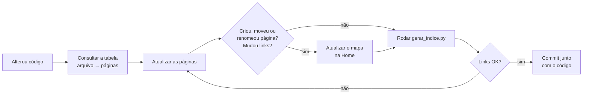

# Manutenção da wiki

Como manter a wiki fiel ao código. Vale para pessoas e para agentes de IA
(Claude Code, Codex etc.) que alterem este repositório.

## Regra de ouro

> **Código e wiki mudam juntos, no mesmo commit ou PR.** A wiki descreve o
> sistema como ele está no `develop`, não como foi planejado.

Se uma mudança de código deixa alguma frase da wiki falsa, essa frase precisa
ser corrigida na mesma entrega.

## Fluxo de atualização



## O que atualizar quando o código muda

### Backend

| Arquivo alterado | Páginas a revisar |
|---|---|
| `backend/app/main.py` (rotas, códigos HTTP, timeout, CORS) | [Referência da API](03-backend/api-referencia.md), [Visão geral do backend](03-backend/README.md), [Solução de problemas](06-operacao/solucao-de-problemas.md); se mudar o fluxo, [Fluxo da aplicação](02-arquitetura/fluxo-da-aplicacao.md) |
| `backend/app/contracts.py` | [Contratos de dados](02-arquitetura/contratos-de-dados.md), [Saída estruturada](04-agente/saida-estruturada.md), [Estado e integração](05-frontend/estado-e-integracao.md); rodar `backend/scripts/export_contracts.py` e atualizar `frontend/src/types.ts` |
| `backend/app/agent.py` — `AGENT_INSTRUCTIONS` | [Instruções e políticas](04-agente/instrucoes-e-politicas.md) |
| `backend/app/agent.py` — ferramenta, limites, modelo | [Ferramenta `search_market_items`](04-agente/ferramenta-search-market-items.md), [Ciclo de execução](04-agente/ciclo-de-execucao.md), [Visão geral do agente](04-agente/README.md), [Configuração](03-backend/configuracao.md) |
| `backend/app/recommendations.py` | [Regras de negócio](03-backend/regras-de-negocio.md), [Saída estruturada](04-agente/saida-estruturada.md) |
| `backend/app/ifood_mcp.py` | [Integração MCP](03-backend/integracao-mcp.md), [Ferramenta `search_market_items`](04-agente/ferramenta-search-market-items.md) |
| `backend/app/oauth.py` | [Autenticação OAuth](03-backend/autenticacao-oauth.md), [Segurança e privacidade](02-arquitetura/seguranca-e-privacidade.md) |
| `backend/app/context.py` | [Contexto e sessões](03-backend/contexto-e-sessoes.md) |
| `backend/app/vision.py` (validação da foto, prompt de captura, limites) | [Reconhecimento de imagem](04-agente/reconhecimento-de-imagem.md), [Referência da API](03-backend/api-referencia.md), [Configuração](03-backend/configuracao.md), [Segurança e privacidade](02-arquitetura/seguranca-e-privacidade.md) |
| `backend/app/settings.py`, `.env.example`, `requirements.txt` | [Configuração](03-backend/configuracao.md), [Como rodar](06-operacao/como-rodar.md), [Visão geral da arquitetura](02-arquitetura/visao-geral.md) (stack) |
| `backend/tests/` | [Testes](03-backend/testes.md) (lista e contagem de testes) |
| Novo módulo em `backend/app/` | [Visão geral do backend](03-backend/README.md) (estrutura e mapa dos módulos) e uma página nova, se o módulo tiver regras próprias |

### Frontend

| Arquivo alterado | Páginas a revisar |
|---|---|
| `frontend/src/App.tsx` (etapas, estado, efeitos, mensagens ao agente) | [Fluxo de telas](05-frontend/fluxo-de-telas.md), [Estado e integração](05-frontend/estado-e-integracao.md), [Fluxo da aplicação](02-arquitetura/fluxo-da-aplicacao.md) |
| `frontend/src/api.ts` | [Estado e integração](05-frontend/estado-e-integracao.md), [Referência da API](03-backend/api-referencia.md) (se a rota for nova) |
| `frontend/src/flow.ts` | [Estado e integração](05-frontend/estado-e-integracao.md) |
| `frontend/src/types.ts` | [Contratos de dados](02-arquitetura/contratos-de-dados.md) (divergências) |
| `frontend/src/steps/*` | [Fluxo de telas](05-frontend/fluxo-de-telas.md), [Componentes](05-frontend/componentes.md) |
| `frontend/src/components/*` | [Componentes](05-frontend/componentes.md), [Design e acessibilidade](05-frontend/design-e-acessibilidade.md) |
| `frontend/src/index.css`, `frontend/index.html` | [Design e acessibilidade](05-frontend/design-e-acessibilidade.md) |
| `frontend/package.json`, `vite.config.ts` | [Visão geral do frontend](05-frontend/README.md), [Como rodar](06-operacao/como-rodar.md) |

### Mudanças transversais

| Situação | Páginas a revisar |
|---|---|
| Funcionalidade nova ou lacuna resolvida | [Estado atual](01-visao-geral/estado-atual.md), [Limitações e roadmap](06-operacao/limitacoes-e-roadmap.md), [Produto](01-visao-geral/produto.md) (escopo do MVP) |
| Nova ferramenta do MCP (ex.: carrinho) | [Integração MCP](03-backend/integracao-mcp.md), [Visão geral do agente](04-agente/README.md), [Instruções e políticas](04-agente/instrucoes-e-politicas.md), [Segurança e privacidade](02-arquitetura/seguranca-e-privacidade.md), [Fluxo da aplicação](02-arquitetura/fluxo-da-aplicacao.md) |
| Decisão de arquitetura nova ou revista | [Decisões arquiteturais](02-arquitetura/decisoes-arquiteturais.md) (nova entrada `DA-NN`; não apague as antigas, marque como substituídas) |
| Termo novo no código ou na interface | [Glossário](01-visao-geral/glossario.md) |
| Erro novo que alguém pode encontrar | [Solução de problemas](06-operacao/solucao-de-problemas.md) |

### Fora da wiki

Estes documentos também descrevem o sistema e podem precisar de ajuste:

- [`backend/README.md`](../../backend/README.md) e
  [`frontend/README.md`](../../frontend/README.md): guias rápidos de cada parte.
- [`docs/entregaveis/`](../entregaveis/README.md): os seis entregáveis do
  hackathon, principalmente o 01, o 02, o 04 e o 05.
- [`docs/AVALIACAO-ENTREGAVEIS.md`](../AVALIACAO-ENTREGAVEIS.md).
- [`docs/contracts/`](../contracts/): regenerados por script, nunca à mão.

## Checklist do PR

- [ ] Revisei as páginas da tabela acima para cada arquivo alterado.
- [ ] Números citados (limites, timeouts, contagem de testes, versões) foram
      conferidos no código.
- [ ] Atualizei [Estado atual](01-visao-geral/estado-atual.md) se algo passou a
      funcionar ou deixou de funcionar.
- [ ] Se criei, movi ou renomeei uma página, atualizei o mapa da
      [Home](README.md).
- [ ] Rodei `python docs/wiki/_scripts/gerar_indice.py`, e ele terminou sem
      links quebrados.
- [ ] Nenhuma credencial, token ou dado pessoal foi incluído.

## Convenções de escrita

| Tema | Convenção |
|---|---|
| Idioma | Português do Brasil |
| Verdade | Descrever o que existe no `develop`. O que não existe recebe **❌ Não existe** ou "não implementado" |
| Título | Um único `#` por página, com nome curto |
| Fim da página | Seção `## Veja também` com 2 a 4 links relacionados |
| Código | Caminhos como `backend/app/agent.py`; trechos curtos e literais, copiados do código |
| Links | Sempre relativos (`../03-backend/api-referencia.md`), nunca URLs do GitHub |
| Diagramas | Mermaid (o GitHub renderiza); um diagrama por ideia |
| Exemplos de dados | Sintéticos, como "Produto fictício" e coordenadas públicas |
| Segurança | Nunca incluir credenciais, tokens, URLs de callback com `code` ou dados pessoais |
| Tom | Frases diretas; tabelas para referência, texto para explicação |

## Criar uma página nova

1. Escolha a pasta da seção (`01-visao-geral`, …, `06-operacao`). Uma pasta
   nova também precisa entrar em `SECTIONS`, no script do índice.
2. Use nome em minúsculas, com hífens e sem acentos: `nova-pagina.md`.
3. Comece com `# Título` e um parágrafo dizendo o que a página cobre e onde está
   o código.
4. Termine com `## Veja também`.
5. Acrescente a página ao **Mapa da wiki** na [Home](README.md) e, se fizer
   sentido, ao roteiro "Comece pela sua necessidade".
6. Linke a página a partir de pelo menos uma página relacionada, para ela não
   ficar órfã.
7. Rode o script do índice.

Para **mover ou renomear**, rode o script: ele lista todos os links que
quebraram.

## Índice e verificação de links

O [Índice](INDICE.md) é **gerado** a partir das páginas. Ele mostra todas as
páginas, os links entre elas, os arquivos do repositório que cada uma cita, um
mapa visual e as páginas órfãs.

```bash
# a partir da raiz do repositório
python docs/wiki/_scripts/gerar_indice.py          # regenera INDICE.md
python docs/wiki/_scripts/gerar_indice.py --check  # só verifica (útil em CI)
```

O script:

- Verifica se cada link relativo aponta para um arquivo existente.
- Verifica se cada âncora (`pagina.md#secao`) corresponde a um título real, no
  padrão do GitHub.
- Ignora links dentro de blocos de código.
- Termina com código `1` se houver problema. Com `--check`, termina com código
  `1` também quando o `INDICE.md` está desatualizado.

## Atualizações pendentes

Mudanças já conhecidas que ainda não chegaram ao `develop`. Quando chegarem,
atualize as páginas listadas e remova o item daqui.

Nenhuma no momento.

Histórico: a foto (`POST /api/context/parse-image`) e o `contexto_reconhecido`
entraram no `develop` com o merge de `codex/mvp-finalizacao` (commit `218a98c`),
e a wiki foi atualizada no mesmo dia. Fora da wiki, ainda falta revisar
`docs/entregaveis/04-interface-visual.md`, `docs/entregaveis/05-documento-tecnico.md`
e `docs/AVALIACAO-ENTREGAVEIS.md`, que ainda citam a foto como não funcional.

Modelo para uma pendência nova:

```markdown
### <Nome da mudança>

<Onde está a mudança e quando deve chegar ao develop.>

- [ ] <Página> : <o que mudar>
```

## Instrução para agentes de IA

Texto para colocar no `CLAUDE.md` ou no `AGENTS.md` do repositório, se a equipe
quiser que os agentes sigam esta regra automaticamente:

```markdown
## Documentação
- A wiki em docs/wiki/ descreve o código do develop. Ao alterar código, atualize
  no mesmo commit as páginas indicadas em docs/wiki/MANUTENCAO.md
  ("O que atualizar quando o código muda").
- Depois de editar a wiki, rode `python docs/wiki/_scripts/gerar_indice.py` e
  corrija qualquer link quebrado.
- Nunca inclua credenciais, tokens ou dados pessoais na documentação.
```

## Veja também

- [Home da wiki](README.md)
- [Índice da wiki](INDICE.md)
- [Estado atual](01-visao-geral/estado-atual.md)
